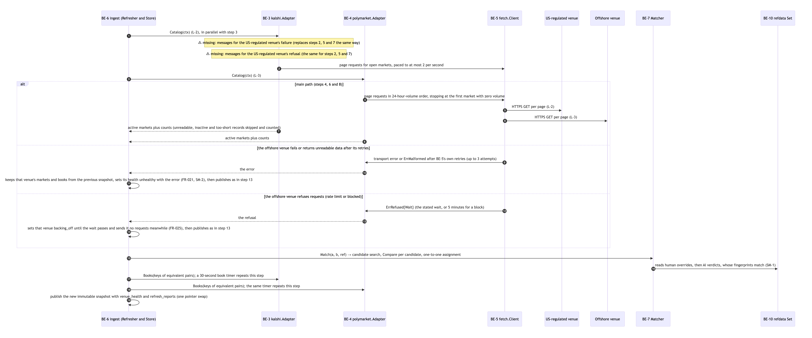
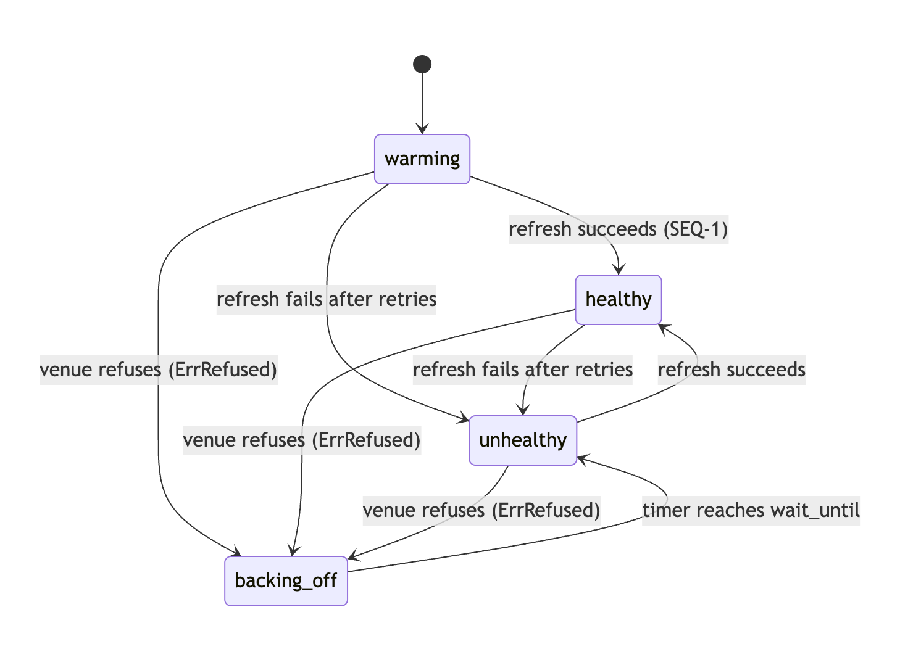
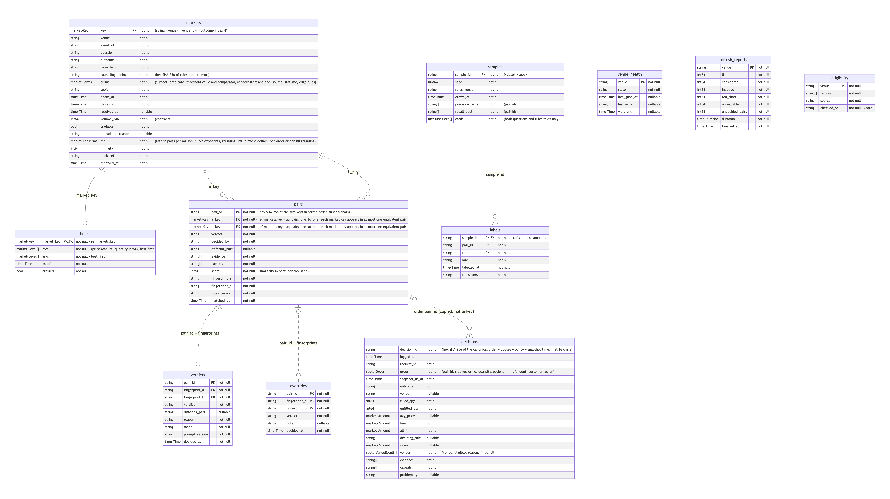
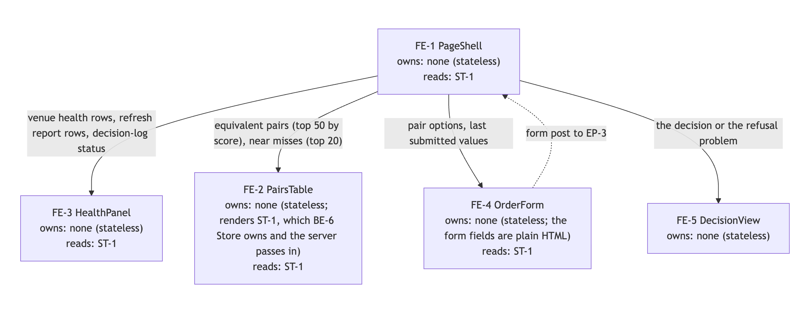

# Architecture overview

Equinox answers one question for PEAK6 Labs: when two prediction-market venues list what looks like the same bet, is
it really the same bet, and if so, where should an order go? This page is the short version, in pictures. The full
reasoning lives in [`docs/architecture/hld.md`](docs/architecture/hld.md) (the big picture) and
[`docs/architecture/lld.md`](docs/architecture/lld.md) (every record, component and step). Each picture below is drawn
from a Mermaid file in [`docs/architecture/diagrams/`](docs/architecture/diagrams/); click one to open it full size.

## 1. Who Equinox talks to

Equinox reads public market data from two venues: Kalshi, which is US-regulated, and Polymarket, which is offshore.
People use it through one page and a small API. AI is outside the system: it only labels and reviews pairs offline,
through files that a person approves.

## 2. What runs where

One Go service does the live work. In the background it refreshes both venues and keeps an unchanging copy of
everything it knows, like a photo retaken every few minutes. Routing an order only ever looks at that photo, so it
never waits on a venue and the same order always gets the same answer. Every decision is written to an append-only
log before the answer goes out. Reviewed data (AI verdicts, customer eligibility) lives in git and ships inside the
image.

## 3. The two core journeys

**Matching** (every refresh): read both catalogs, find candidate pairs by rare shared words, compare their settlement
parts (outcome, threshold, statistic, window, edge rules), and keep a pair only when every part agrees. Anything the
rules can't settle is marked undecided, never guessed.

**Routing** (every order): check the order, read the photo, ask each venue's facts (price, fees, depth, health,
whether this customer may use it), pick the winner by fixed rules, log it, answer.

## 4. When things go wrong

A venue that times out keeps its last good data and is marked unhealthy; its prices age out of decisions after 90
seconds. A venue that refuses requests gets left alone until its wait time passes.

## 5. How a pair earns "equivalent"

Rules decide most pairs. AI reviews the rest offline, and a person can override either. If a market's rules text
changes later, the pair goes stale and is matched again.

## 6. The data and the code

There is no database. These records live in memory inside the photo, in the decision log file, or as reviewed files
in git. Money is a whole number of micro-dollars, so prices never drift from rounding.

Each venue has its own adapter. The router knows nothing about which venue is which.

## Why it is shaped this way

Every choice above was made at a human gate and is recorded, with the options that lost, in
[`docs/decisions/DECISION_JOURNAL.md`](docs/decisions/DECISION_JOURNAL.md): Go with the standard library only (D13),
one service with immutable snapshots (D14), a log file instead of a database (D15), AI only offline through reviewed
files (D10, D16), recorded real venue responses as the offline data (D17), and matching by settlement parts (D19-D20).
