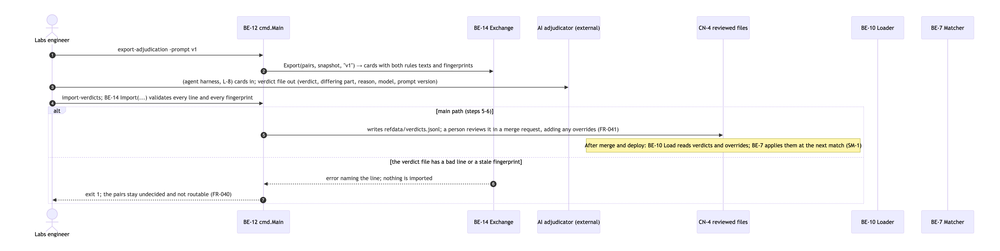
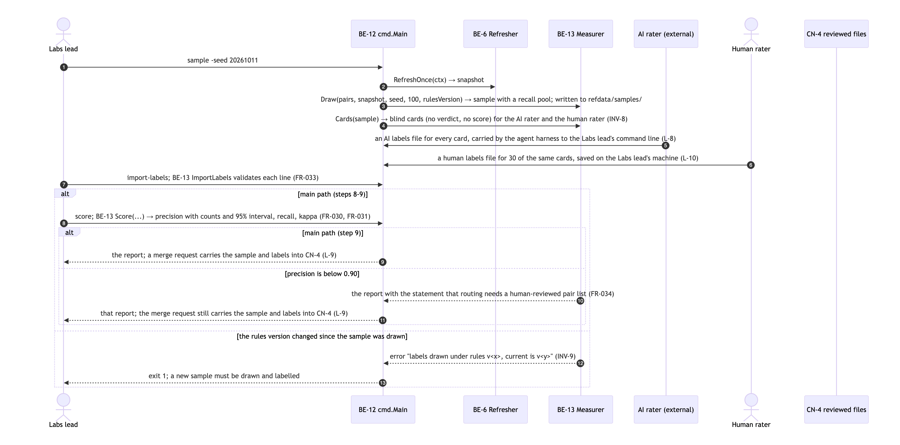
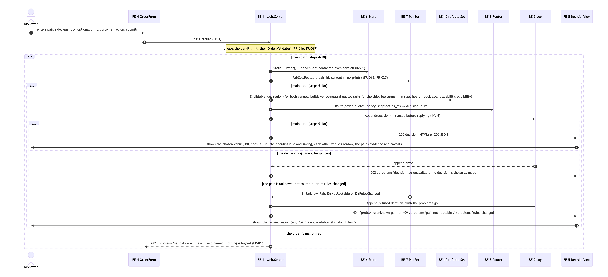

# AI usage log

The assignment asks that AI use be disclosed with the reasoning behind it. This log covers how AI built Equinox, and
where AI sits (and does not sit) inside the running system.

## Summary

| | |
|---|---|
| Developer | Sefath Chowdhury |
| AI tool | Claude Code (model claude-opus-5-5) in the Claude desktop app, run through a personal "software-factory-kit" workflow |
| How it was used | The developer made every product and design decision at a human gate; the AI drafted each artifact, ran research and builds, and recorded the developer's exact words before acting. Each gate answer is a dated entry in `.handoff/TRACKER.md ## Approvals` and a `D<n>` entry in `docs/decisions/DECISION_JOURNAL.md` |
| AI in the routing path | **None.** Routing is a deterministic Go function over a frozen snapshot (D10, INV-1) |
| AI in matching | **Offline only, and optional:** pairs the deterministic rules cannot settle can be exported, adjudicated by an AI agent outside the product, reviewed by a person in a merge request, and only then read by the router (D10, D16) |
| AI in measurement | An AI rater labels a blind sample (it never sees the system's verdict or score); a blind quorum of three models (Fable, Opus, Sonnet; majority of 3) labelled 30 of the same pairs and agreement is reported as Cohen's kappa. The plan (D9) was for the developer to be that second rater; under the deadline the developer chose the model quorum instead, disclosed in `docs/TEST_RESULTS.md` |

### Where AI sits, in pictures

AI reviews undecided pairs offline, and its verdicts only reach the router after a person merges them:

AI and human raters label blind cards to measure matching quality:

The router itself never calls a model (the "Route" step reads only the snapshot):

## Why v2 exists

v1 (in `main`'s history at `9c3bf48`) was built in one unattended AI session from a single prompt. It worked, but the
AI made the decisions. v2 restarted on a branch (D1) so that every decision passed a human gate: "AI can catch what's
broken, but can't catch what's wrong". v1 is cited only as a prior experiment: none of its code or design was carried
over without a gate choosing it (D3).

## How the work was split

| Phase | AI did | Human decided | Record |
|---|---|---|---|
| Decode the prompt | read the prompt as a grader would; named 3 hypotheses and 14 traps | the frame (feasibility verdict), v1 policy, finishing today | D1-D4 |
| Brief | mapped 30 requirements from both deliverable lists; metric candidates | track (Full); submission and hosting answers | D5-D6 |
| Research | 8 researchers in parallel, then an adversarial verifier per question re-reading every load-bearing source (8 claims moved to gaps) | approved the evidence | `docs/research/` |
| PRD | drafted from the evidence; 5 questions | what "equivalent" means, venues and eligibility, how precision is measured and gated, where AI may sit, which markets count | D7-D12 |
| Design (HLD, LLD) | drafted; 13 diagrams drawn by separate subagents from the text only, which caught 3 HLD and 8 LLD inconsistencies before any code | language (Go), topology, storage, AI integration, matching grain and method; two revisions | D13-D23 |
| Build | shared types and integration by the main session; router, venue adapters and matcher by 3 parallel subagents, each in its own git worktree, merged after review | fast flow near the deadline (batched gates) | D22, `specs/M4-build/` |

## Mistakes the AI made, and what caught them

1. **Inconsistent design text** (an ID naming two components, a branch that would answer twice, a state owner
   named two ways): caught by the diagram subagents, which may only draw what the text says. Fixed through gated
   revisions before code existed.
2. **A wrong timestamp in a journal entry** (16:21 instead of 16:19): caught by the AI comparing against the
   Approvals row before pushing; corrected in the unpushed commit.
3. **Shell list handling** (`zsh` does not split a variable into words): a move step failed; caught by the command
   error and redone; nothing was lost.
4. **Firewall:** a locally built Go binary cannot reach the venues on this Mac. The adapter worker added a
   curl-backed transport, so live runs work without changing the firewall.

## Limits of the AI-produced evidence

- AI labels are a strong second opinion, not ground truth. Every rater was a Claude model, so their unanimity can hide a shared blind spot; human labels remain the open check.
- The US-regulated venue's fee schedule could not be read by the research agents (HTTP 429); the fee is an
  assumption until a person reads it.
