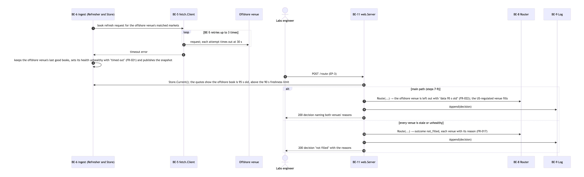
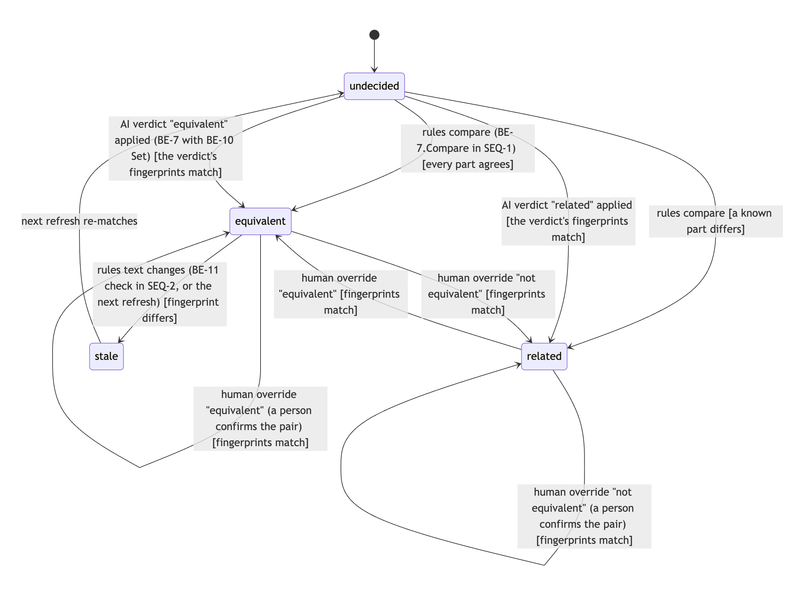

# Test results

Measured on 2026-10-11 from `milestone/m4-build`. Every number here can be regenerated offline from the committed
recording `testdata/live-20261011` (a full live read of both venues that day).

## 1. Automated tests

`make check` (gofmt, `go vet`, every test, diagrams in sync, decision views current): **OK**.
`go test -race -cover ./...`: **70 tests run (including subtests), 70 passed, 0 failed**. Raw output:
[`test-results/go-test-race-cover.txt`](../test-results/go-test-race-cover.txt).

| Package | Coverage | What its tests prove |
|---|---|---|
| `internal/route` | 94.3% | Fees decide the venue; the same order and snapshot give the same decision (INV-2); ineligible and stale venues are skipped with a reason |
| `internal/match` | 95.1% | Equivalent only when every settlement part agrees; a stated threshold or statistic difference is "related" with the part named; one-to-one assignment, loser becomes a near miss |
| `internal/market` | 78.5% | Integer micro-dollar money, fee rounding up, book validation (crossed or empty books refused) |
| `internal/venues/kalshi`, `.../polymarket` | 79.6%, 87.2% | Adapters read recorded real responses into the venue-neutral model; one failed series does not drop the venue |
| `internal/web` | 53.9% | Routing contacts no venue (INV-1); malformed orders rejected with problem+json and not logged; a venue that goes down keeps its last good data, is marked unhealthy and the decision names it |
| `internal/decisionlog`, `refdata`, `measure`, `fetch`, `venue` | 72-88% | Log synced before answering (INV-6); reviewed data validated on load; seeded sampling, Wilson interval, kappa; record/replay |

`cmd/equinox`, `internal/ingest` and `internal/adjudicate` have no unit tests of their own; they are exercised through
`internal/web` and the end-to-end runs below.

## 2. End-to-end run on live data

`./bin/equinox refresh` on the 2026-10-11 read ([`test-results/live-refresh-2026-10-11.txt`](../test-results/live-refresh-2026-10-11.txt)):

| | Kalshi | Polymarket |
|---|---|---|
| Open markets listed | 118,696 | 20,886 |
| Active (traded in the last 24 h, open at least an hour) | 19,195 | 20,743 |

**Pairs:** 12 equivalent, 2,116 related but not routable (a named settlement part differs), 0 left undecided after
the offline AI adjudication (57 sent, 12 equivalent, 45 related; reviewed into `refdata/verdicts.jsonl`).

**Routing** (pair `96fd378f2b486591`, Messi wins the 2026 Ballon d'Or, buy YES, 500 contracts):

| Customer | Venue | All-in cost | Deciding rule |
|---|---|---|---|
| US | Kalshi | $21.35 | only eligible venue (the offshore venue is not offered to US customers) |
| non-US | Polymarket | $11.32274 | lowest all-in cost after fees; saves $10.03 over Kalshi |

**Graceful failure:** replaying with one venue's responses removed prints that venue as `unhealthy` with its last
error, keeps the other venue healthy, and finds 0 pairs instead of crashing (`./bin/equinox refresh -replay <dir with only kalshi/>`).

## 3. Matching quality

Method (D9): a seeded random sample (seed 20261011) of the system's equivalent pairs measures **precision**; a seeded
pool of 100 high-scoring rejected pairs measures **recall**. Raters see only blind cards (both questions and rules,
never the verdict, score or evidence; INV-8). Gate: precision ≥ 0.90 (aspirational 0.95).

| Metric | Result | Rater |
|---|---|---|
| Precision | **12 / 12 = 1.00**, 95% Wilson interval **0.76 - 1.00** | AI rater 1, all 12 equivalent pairs |
| Recall | **12 / 15 = 0.80** | AI rater 1, 12 found + 100-pair rejected pool |
| Quorum check | **30 / 30 unanimous; every pairwise Cohen's kappa = 1.00** | Three fresh blind raters on 30 pairs (12 precision + 18 pool), one per model: Fable 5.1, Opus 5.5, Sonnet 5.5; majority of 3 decides. The quorum confirms all 12 equivalents and finds no equivalent in the 18 pool pairs, the same as AI rater 1 |

Labels: `refdata/labels/20261011-20261011.jsonl` (rater 1); `test-results/labels-rater-{fable,opus,sonnet}.jsonl` (quorum raters, each with a one-line reason per pair); `test-results/labels-quorum.jsonl` (votes and majority).
Reproduce: `./bin/equinox score -sample refdata/samples/20261011-20261011.json`.

How the measurement runs, and how a pair's verdict can change:

### What these numbers do not show

- **No human labels.** The plan (D9) was a blind human second rater; it was not done before the deadline. The
  developer chose a quorum of three models instead, each a fresh agent that read only the blind sheet. No other
  vendor's model was available on this machine, so all three are Claude models: a quorum removes one model's noise,
  but models from one family can share a blind spot, so unanimity here is weaker evidence than human agreement.
- **The precision gate is not yet proven.** 12/12 has a lower bound of 0.76, below the 0.90 gate: the sample is too
  small. About 35 equivalent pairs, all correct, would be needed for the lower bound to clear 0.90.
- **Narrow coverage.** All 12 equivalent pairs come from two event families (TIME Person of the Year, the Ballon d'Or).
  Precision on other topics (sports props, prices, elections) is unmeasured.
- **Weakest calls.** All three quorum raters named the same doubts: the three TIME pairs (one venue resolves NO if
  there is no announcement by 30 June 2027, the other states no deadline; group winners could be read differently) and
  the Ballon d'Or "no winner by 31 Dec 2026" rule on one side only. Each judged these implausible to split in practice;
  a strict reading would make precision 9/12 (TIME out) or 3/12 (both out).
- **Recall misses.** The 3 missed equivalents differ only in how a threshold is written (for example "at least N"
  vs "more than N - 0.5"). Normalising inclusive and exclusive thresholds would recover them.
- **Noisy "related" pool.** Candidate generation can pair markets that share no subject (on the small test fixture, a
  Miami temperature market against a Bitcoin price market, both "above" a number). They are correctly not routable,
  but the near-miss list is less useful until candidates require a shared subject.
- **Fee assumption.** Kalshi's fee is assumed (0.07 × series multiplier × p × (1 - p), rounded up to the cent) until
  its fee schedule is read by a person.

## 4. Verdict on the three feasibility questions

1. **Can venues be normalised?** Yes, for binary propositions: both venues map to one model with no venue logic in
   routing. The hard part is settlement text, not prices.
2. **Architectural tradeoffs:** a frozen snapshot plus a pure router buys determinism and no blocking, at the cost of
   data up to one refresh old (a stale venue ages out after 90 s). AI is kept offline and reviewed, so it never sits in
   the routing path.
3. **How complex is routing?** Small once equivalence is settled (fees, depth, eligibility, a tie-break). Equivalence
   detection is where the risk and the effort are; on this day's data, true equivalents across the two venues were rare
   (12 of about 20,000 active markets per side).
