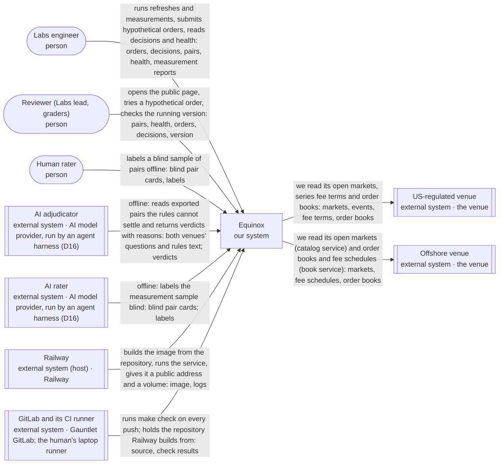
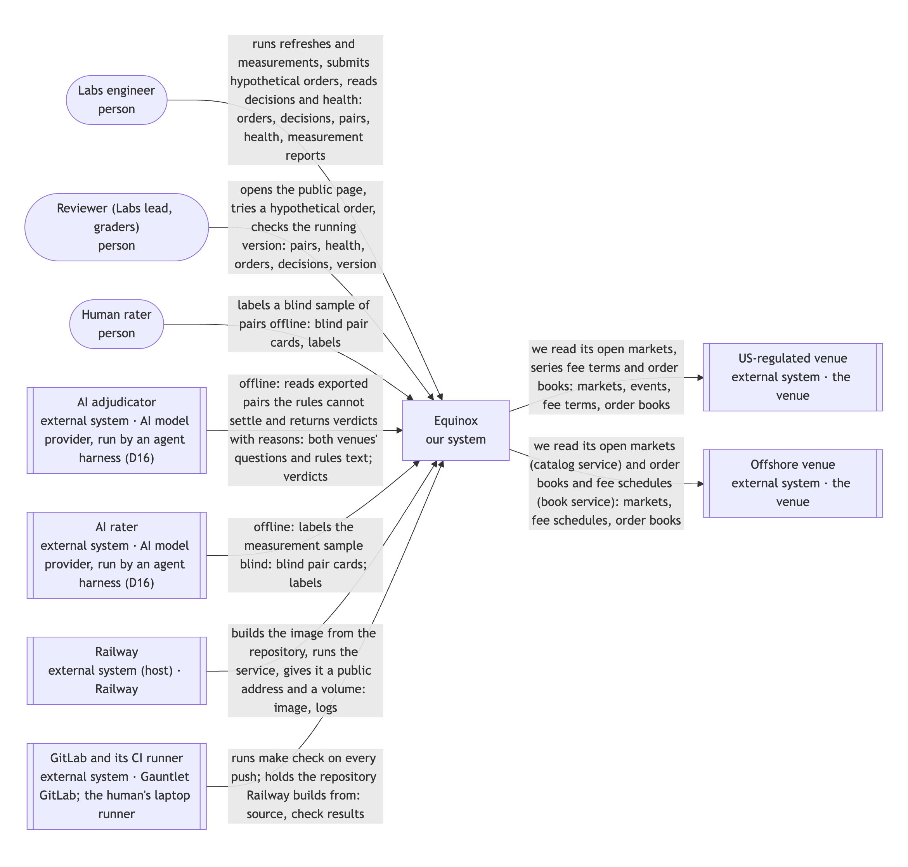
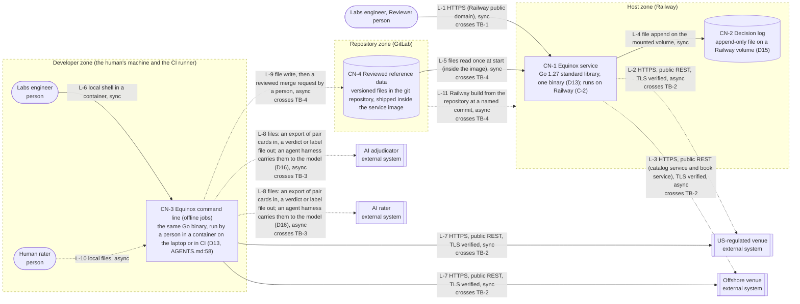
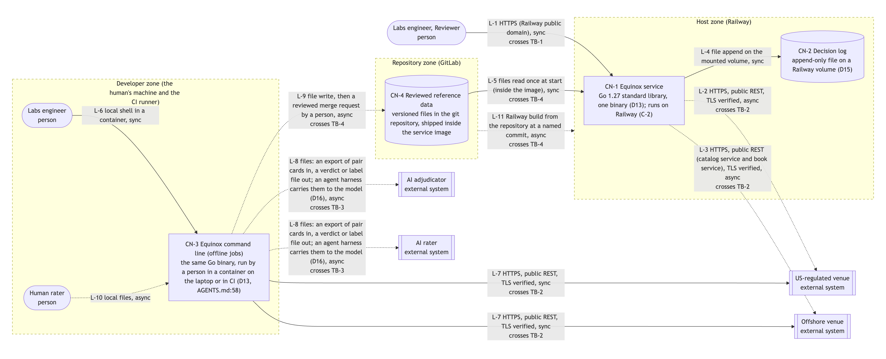
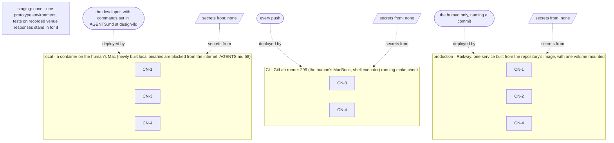
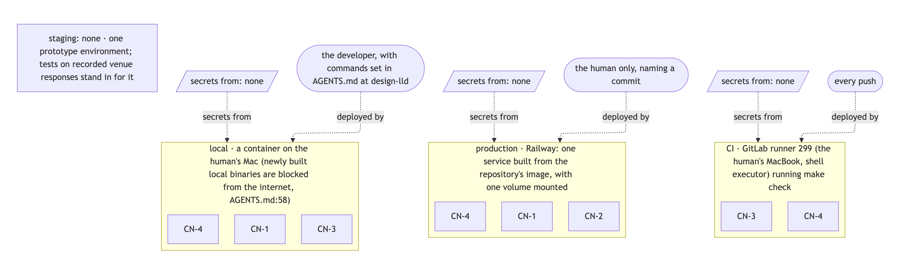

# Equinox — High-level design

| Field | Value |
|---|---|
| PRD | `docs/product/prd.md` @ 40eb5d5 |
| Milestone | M3-design |
| Mode | greenfield (v1 at main@9c3bf48 is a cited prior experiment only, D3) |
| Last updated | 2026-10-11 16:24 CDT |
| Written by | design-hld (Claude Code, claude-opus-5-5) |
| Approval | G2 — recorded in `.handoff/TRACKER.md ## Approvals` (never in this file); decisions in `docs/decisions/DECISION_JOURNAL.md` |

**How to read this HLD.** A *container* is something that runs or stores data on its own (an app, a database, a
queue). A *connection* is an arrow between two of them and how it talks (sync = the caller waits for the answer;
async = it hands off a message and moves on). A *trust boundary* is a line where data passes to a party with
different permissions. An *invariant* is a rule that must always hold, or data, money or trust is corrupted. A
*D<n>* is a decision put to you at G2: Type 1 = one-way door, expensive to undo; Type 2 = two-way door, cheap to
change later. Anything not known yet carries a warning sign and a Q-n id; §13 lists every one with a recommended
answer.

## Inputs read

| Path | Version (sha or date) | Used for |
|---|---|---|
| `docs/product/prd.md` | 40eb5d5 | drivers, constraints, non-goals, NFR numbers |
| `AGENTS.md` | 7924a39 | stack still open (AGENTS.md:57), firewall gotcha (AGENTS.md:58) |
| `docs/decisions/DECISION_JOURNAL.md` | 331e5c0 | accepted D1-D12 as givens; next id D13 |
| `specs/M1-cross-venue-equivalence-routing/brief.md` | c0e0111 | appetite, parking lot P-01..P-10 as first proposals |
| `specs/M1-cross-venue-equivalence-routing/decode.md` | d20fb08 | traps T-5 (determinism undefined), T-6 (stack), T-13 (AI vs determinism) |
| `docs/research/R01`-`R08`, `docs/research/sources.md` | c1c023e | venue access and limits (R01), overlap (R02), settlement fields (R03), fees and rounding (R04), measurement (R05), eligibility (R06), load (R08) |
| write-prd STOP "Parked for design-hld" line | this session, 2026-10-11 | language and hosting, refresh cadence, money representation, frozen fee and eligibility data, matching grain, label storage, polling vs streaming, catalog listing |
| railway.com/pricing | pricing page checked 2026-10-11 | §12 unit prices: Hobby $5 with $5 usage included; memory $10 per GB-month; CPU $20 per vCPU-month; volume $0.15 per GB-month; egress $0.05 per GB |
| Live checks of both venues' public listings | 2026-10-11 16:08 CDT | the offshore venue's listing returns markets ordered by 24-hour volume (descending); the US-regulated venue's market records carry a 24-hour volume field |
| `go version` | 2026-10-11 | go1.27.1 darwin/arm64 is installed (D13) |

**Not read:** `docs/design/` — does not exist (map-ux-flows skipped: no P1 story needs a designed screen, REQ-29) ·
v1 source code at main@9c3bf48 — deliberately not used as design input (D3); its ideas appear only as the brief's
parked options.

## 1. Context & goals

Equinox collects two prediction-market venues' active markets, proposes pairs that would pay the same side in every
outcome (with evidence), and simulates routing a hypothetical order between them with a stated reason, for PEAK6
Labs engineers deciding whether cross-venue infrastructure is viable. The quality that matters most is that
**routing decides only from frozen data it already holds**: the same order on the same data must give the same
decision every time (FR-013, NFR-001), and no decision may wait on a venue (FR-020, NFR-002). Everything that talks
to the outside world, or to an AI model, happens before routing reads its inputs.

### Drivers

| Id | Requirement (short) | Kind | How it shapes the design |
|---|---|---|---|
| FR-001 | Collect active markets from each venue on every refresh | FR | a background refresher on a cadence, separate from the routing path |
| FR-004 | Propose equivalent pairs with evidence per part of the definition | FR | matching runs after each catalog refresh and produces a pair set routing reads |
| FR-008 | Return one routing decision with venue, fill, price, fees, all-in cost | FR | a request path (web form and command line) into one routing step |
| FR-009 | All-in cost from visible depth and the market's published taker fee | FR | order books and per-market fee terms must be held in the snapshot |
| FR-012 | Every decided or refused order readable later from a decision log | FR | durable storage that survives restarts (D15) |
| FR-013 | Same order + same frozen data → identical decision | FR | immutable snapshots, a fixed order over inputs, exact integer money |
| FR-014 | Route from venue-neutral facts only | FR | a hard boundary: venue knowledge lives only in the two venue readers |
| FR-020 | Never contact a venue while deciding | FR | routing reads only the latest published snapshot |
| FR-021 | Keep last good data and mark a failing venue unhealthy | FR | per-venue health kept beside each venue's last good snapshot |
| FR-027 | Stop routing a pair whose rules changed after matching | FR | each pair remembers a fingerprint of both rules texts |
| FR-028 | Fixed-seed measurement sample of equivalent pairs | FR | an offline measurement job and versioned label files |
| FR-035 | Customer-region eligibility per venue as declared data | FR | a reviewed eligibility file loaded at start |
| FR-038 | Offline AI adjudication of pairs the rules cannot settle | FR | an export/import path to an AI outside the routing path (D16) |
| FR-042 | A public page showing pairs, health and an order form | FR | the service must be reachable from the internet on the host (C-2) |
| NFR-002 | 0 requests to any venue while deciding | NFR | rules out fetching books on demand |
| NFR-003 | At most 2 requests per second to each venue | NFR | a per-venue request pacer; sizes the refresh time |
| NFR-004 | A full refresh of both venues' active markets within 15 minutes | NFR | rules out sweeping every open market of the larger venue (2,489 pages ÷ 2 req/s ≈ 21 min, R08) |
| NFR-005 | Fees match each venue's published rounding in 100% of worked examples | NFR | fees are data (a curve per market) computed in integer units |
| NFR-006 | 100% of decided or refused orders readable from the log | NFR | append before answering |
| NFR-007 | 0 items of venue secret material | NFR | no venue accounts; reading public data only |

### Given constraints (fixed inputs, not decisions)

| Source (C-n, AGENTS.md:line or accepted D<n>) | Constraint | Design consequence |
|---|---|---|
| C-1, D8 | Two venues, public unauthenticated data only: the US-regulated venue and the offshore venue | two venue readers; no write path to any venue; no credentials anywhere |
| C-2 | A live instance runs on Railway | one hosted service with a public address and a persistent volume (§11) |
| C-3 | Partner documents paraphrased, never committed | nothing from partner documents ships in the repo or the image |
| C-4, D4 | Hard date 2026-10-11 23:30 CDT; main updated only when v2 is green | the simplest topology that meets the drivers; recorded venue responses for tests |
| C-5 | No real trading, wallets, regulatory implementation or production UI | no order placement, no identity checks, a plain page |
| D7 | Equivalent = same payout in every outcome; timing only as a caveat | matching compares question, source, statistic, window, threshold and edge-case rules |
| D9 | Blind, fixed-seed sampled precision with recall and kappa | measurement is an offline job writing versioned label files |
| D10 | AI only offline, as an adjudicator; routing never calls a model | the AI sits outside the service (TB-3); its verdicts are frozen files |
| D11 | Active markets only (a trade in 24 h, life ≥ 1 h) | the refresher filters at the source where the venue allows it |
| AGENTS.md:57 | Stack undecided until this gate; the partner prefers Go and GCP | the language is D13; hosting is already C-2 |
| AGENTS.md:58 | Newly built local binaries cannot reach the internet on this Mac | live runs on the laptop go through a container (§11) |

### Non-goals carried from the PRD

- NG-1 → no order placement, no wallet, no venue account: the design has read-only connections to venues.
- NG-2 → eligibility is a reviewed data file, not a rules engine or identity check.
- NG-3 → one plain page for pairs, health and an order form; no front-end application.
- NG-4 → exactly two venue readers; adding a third is a new reader plus data, no routing change (FR-014).
- NG-5 → quiet markets and sub-hour windows are never fetched in full or matched.
- NG-6, NG-7 → one venue per decision, filled against visible depth; no splitting or impact model.

## 2. System context (C4 level 1)

<!-- diagram: hld-context -->

<!-- /diagram -->

*Picture of the diagram above (`hld-context.mmd`); click to open it full size.*

| Element | Kind | Interaction with our system | Data exchanged | Owner | Basis |
|---|---|---|---|---|---|
| Equinox | our system | — | — | us | FR-001 to FR-043 |
| Labs engineer | person | runs refreshes and measurements, submits hypothetical orders, reads decisions and health | orders, decisions, pairs, health, measurement reports | PEAK6 Labs | US-1 to US-4 |
| Reviewer (Labs lead, graders) | person | opens the public page, tries a hypothetical order, checks the running version | pairs, health, orders, decisions, version | PEAK6 Labs / Gauntlet | US-7, FR-042, FR-043 |
| Human rater | person | labels a blind sample of pairs offline | blind pair cards, labels | the human (Q3 in the PRD) | FR-029, SC-003 |
| US-regulated venue | external system | we read its open markets, series fee terms and order books | markets, events, fee terms, order books | the venue | C-1, R01, R04 |
| Offshore venue | external system | we read its open markets (catalog service) and order books and fee schedules (book service) | markets, fee schedules, order books | the venue | C-1, R01, R04 |
| AI adjudicator | external system | offline: reads exported pairs the rules cannot settle and returns verdicts with reasons | both venues' questions and rules text; verdicts | AI model provider, run by an agent harness (D16) | FR-038, FR-039, D10 |
| AI rater | external system | offline: labels the measurement sample blind | blind pair cards; labels | AI model provider, run by an agent harness (D16) | FR-031, D9 |
| Railway | external system (host) | builds the image from the repository, runs the service, gives it a public address and a volume | image, logs | Railway | C-2 |
| GitLab and its CI runner | external system | runs `make check` on every push; holds the repository Railway builds from | source, check results | Gauntlet GitLab; the human's laptop runner | WORKFLOW §8 |

## 3. Containers (C4 level 2)

A container is a separately running or deployable runtime boundary that runs code or stores data: a web app, an
API, a background worker, a database, a queue, a cache, an object store. It is not a Docker container.

<!-- diagram: hld-container -->

<!-- /diagram -->

*Picture of the diagram above (`hld-container.mmd`); click to open it full size.*

| Id | Container | Technology | Responsibility | Data owned | Scaling unit | Basis |
|---|---|---|---|---|---|---|
| CN-1 | Equinox service | Go 1.27 standard library, one binary (D13); runs on Railway (C-2) | refreshes venue data in the background, matches, publishes immutable snapshots, routes orders from the current snapshot, serves the page and the health view | current and last good market snapshots per venue, pair set, venue health (in memory) | one instance, vertical (D14) | FR-001, FR-004, FR-008, FR-020, FR-042, D14 |
| CN-2 | Decision log | append-only file on a Railway volume (D15) | keeps every decided or refused order with its inputs and reasons | decisions, refusals | one volume, grows by appending | FR-012, NFR-006, D15 |
| CN-3 | Equinox command line (offline jobs) | the same Go binary, run by a person in a container on the laptop or in CI (D13, AGENTS.md:58) | one-off refresh/match/route runs, recording venue responses for tests, drawing measurement samples, exporting pairs for AI and importing verdicts, computing measurement reports | recorded venue responses (test fixtures), measurement samples and reports | one run at a time | FR-028 to FR-033, FR-038 to FR-041, D16 |
| CN-4 | Reviewed reference data | versioned files in the git repository, shipped inside the service image | the frozen inputs a person reviews in a merge request: eligibility per venue, AI verdicts and human overrides, labels, the matching-rules version | eligibility, AI verdicts, human overrides, labels | grows with review rounds | FR-033, FR-035, FR-039, FR-041, D15 |

## 4. Connections

| Id | From → To | Protocol | Sync / async | Auth | Payload (nouns) | On failure | Basis |
|---|---|---|---|---|---|---|---|
| L-1 | Labs engineer, Reviewer → CN-1 | HTTPS (Railway public domain) | sync | none: public data and simulated orders; per-IP request limit | pairs, health, hypothetical orders, decisions, version | before the first refresh finishes, answers "warming up" with no decision; a refused order shows its reason; over the per-IP limit, "too many requests, try again in N s" | FR-008, FR-042, FR-043, D14 |
| L-2 | CN-1 → US-regulated venue | HTTPS, public REST, TLS verified | async to every request (background polling) | none (C-1) | open markets, events, series fee terms, order books | 30 s timeout per request; up to 3 retries with growing waits on timeouts and server errors; on a rate-limit refusal, no requests until its stated wait passes (FR-025); after that the venue keeps its last good data and is marked unhealthy (FR-021) | FR-001, FR-009, NFR-003, R01, R08 |
| L-3 | CN-1 → Offshore venue | HTTPS, public REST (catalog service and book service), TLS verified | async to every request (background polling) | none (C-1) | open markets ordered by 24-hour volume, fee schedules, order books | same as L-2; a blocked request (403) is treated as a rate-limit refusal with a 5-minute wait (R08 F16) | FR-001, FR-009, NFR-003, R01, R08 |
| L-4 | CN-1 → CN-2 | file append on the mounted volume | sync: the answer is sent only after the append succeeds | the service's own process | decisions, refusals | if the append fails, the order is refused with "decision log unavailable" and health shows the log error (NFR-006) | FR-012, NFR-006, INV-6 |
| L-5 | CN-4 → CN-1 | files read once at start (inside the image) | sync, at start | read-only image contents | eligibility, AI verdicts, overrides, rules version | a missing or invalid file stops the service from starting, with the file named; routing never runs on guessed eligibility | FR-035, FR-041, INV-5 |
| L-6 | Labs engineer → CN-3 | local shell in a container | sync | the person's own machine | commands, reports | the command exits non-zero with the reason | US-4, US-6 |
| L-7 | CN-3 → US-regulated venue, Offshore venue | HTTPS, public REST, TLS verified | sync within a run | none (C-1) | same as L-2 and L-3 | same pacing and retries as L-2 and L-3; a failed venue makes the run report it and stop recording | FR-001, NFR-003 |
| L-8 | CN-3 → AI adjudicator, AI rater | files: an export of pair cards in, a verdict or label file out; an agent harness carries them to the model (D16) | async (a person starts the harness and imports its output) | the person's own AI subscription; no key in the product | pair cards (questions, rules text, no verdict or score for the rater), verdicts, labels | missing or malformed output is rejected on import; affected pairs stay undecided and are counted (FR-040) | FR-038, FR-039, FR-031, D10, D16 |
| L-9 | CN-3 → CN-4 | file write, then a reviewed merge request by a person | async (reviewed before it ships) | git push rights of the human | labels, verdicts, overrides, samples | an unreviewed change never reaches the image: only merged files ship | FR-033, FR-041, D15 |
| L-10 | Human rater → CN-3 | local files | async | the person's own machine | blind pair cards, labels | an incomplete label file is reported as incomplete, never scored | FR-029, FR-031 |
| L-11 | GitLab → Railway | Railway build from the repository at a named commit | async | Railway's GitLab link, set up by the human | source, image | a failed build leaves the previous version running | C-2, FR-043 |

## 5. Trust boundaries & threats

### Boundaries

Every container sits in exactly one trust zone, and zones never overlap; a boundary is the edge a connection
crosses between zones (or from an outside party into a zone).

- **Host zone** (Railway): CN-1 and CN-2. L-4 (service → decision log) stays inside this zone and crosses no
  boundary.
- **Developer zone** (the human's machine and the CI runner): CN-3 and the working copy of the reviewed data. L-6
  and L-10 (people working on their own machine) stay inside this zone.
- **Repository zone** (GitLab): CN-4, the reviewed reference data, changed only by a merged merge request.
- **Outside parties:** anonymous internet users, the two venues, the AI model provider.

| Id | Boundary | Less trusted side | More trusted side | Crossing connections |
|---|---|---|---|---|
| TB-1 | internet → host zone | anonymous browser or script on the internet | host zone (CN-1) | L-1 |
| TB-2 | venues → our zones | the venues' public data | host zone (CN-1) for L-2 and L-3; developer zone (CN-3) for L-7 | L-2, L-3, L-7 |
| TB-3 | AI provider → developer zone | AI model output | developer zone (CN-3) | L-8 |
| TB-4 | the change path: developer zone → repository zone → host zone | unreviewed changes from the developer zone, and anyone who can change Railway settings | repository zone (CN-4, only merged changes) and, after a human deploy of a named commit, the host zone (CN-1) | L-9 (developer → repository), L-11 and L-5 (repository → host) |

### Threats per boundary

| Id | Boundary | STRIDE | Threat (an attacker could ...) | Design mitigation | Residual risk | Basis |
|---|---|---|---|---|---|---|
| TH-1 | TB-1 | D | flood the order form to exhaust CPU or run up the host bill | per-IP request limit; bounded request size; routing is an in-memory lookup; a cost alert at the §8 ceiling | low: no money moves; worst case the page is slow | NFR-002, Q-5 |
| TH-2 | TB-1 | T | send malformed or script-bearing input that is echoed on the page | strict order validation before routing (FR-016); every value and every venue text is escaped when shown | low | FR-016 |
| TH-3 | TB-1 | R | deny having submitted an order | accepted: orders are hypothetical and anonymous; the log records time and decision id, never identity | low: nothing of value is at stake | NG-1 |
| TH-4 | TB-2 | T | serve inconsistent, oversized or hostile data (crossed books, huge pages, script in rules text) | TLS verification; response size caps; each record validated and skipped if unreadable (FR-024); crossed or undated books excluded (FR-023); rules text treated as data and escaped | low | FR-023, FR-024 |
| TH-5 | TB-2 | D | throttle or block our requests | request pacer at 2 req/s per venue (NFR-003); honour stated waits (FR-025); last good data stays in use (FR-021) | med: a shared host IP can be blocked for others' traffic (AR-2) | R08 F16 |
| TH-6 | TB-3 | I | collect data we send to the AI provider | only public market text leaves; no secrets, no personal data, no partner documents in exports | low | NFR-007, C-3 |
| TH-7 | TB-3 | T | steer an AI verdict through instructions hidden in a venue's rules text | rules text is passed as quoted data with an instruction to ignore embedded instructions; verdicts are reviewable files with reasons (FR-039, FR-041); the human's blind labels measure the AI (SC-003) | med: a subtle wrong verdict can survive until measured (AR-5) | R03, SC-003 |
| TH-8 | TB-4 | E | push a change that ships without review, or change what runs | main is protected; reference data changes only through reviewed merge requests; deploys are human-only and name a commit; the page shows the running version (FR-043) | low | C-4, WORKFLOW §2 rule 8 |

## 6. Quality-attribute scenarios

| Id | NFR | Quality | Source | Stimulus | Environment | Response | Measure |
|---|---|---|---|---|---|---|---|
| QA-1 | NFR-001 | determinism | a test | replays 50 orders on one frozen snapshot, once in order and once with every input list shuffled | normal | identical decisions | 100% identical across 3 runs |
| QA-2 | NFR-002 | non-blocking | a Labs engineer | submits an order while both venues are unreachable | degraded: both venues down | a decision from held data, or a stated refusal | 0 venue requests while deciding; answer within 1 s (assumed, ⚠ Q-3) |
| QA-3 | NFR-003 | politeness | the refresher | sweeps both catalogs | normal | requests paced per venue | ≤ 2 requests per second per venue, measured over every 10 s window |
| QA-4 | NFR-004 | refresh time | the refresher | full refresh of both venues' active markets | normal | both catalogs and books replaced | ≤ 15 min end to end (§8: about 4 min expected) |
| QA-5 | NFR-005 | fee accuracy | a test | prices each worked fee example from both venues' fee documents | normal | the published fee | 100% match to the venue's smallest unit |
| QA-6 | NFR-006 | auditability | the host | restarts the service after 40 decisions | degraded: host restart | the log reads back all 40 with inputs and reasons | 100% of decided or refused orders readable |
| QA-7 | NFR-007 | secrets | a reviewer | searches the repository, image settings and logs | normal | nothing secret found | 0 items of venue secret material |
| QA-8 | — | degraded venue | the US-regulated venue | times out on every request | degraded: that venue down | last good data kept, venue unhealthy, its data left out once older than the freshness limit | unhealthy within 1 refresh; stale data excluded after 90 s (§10 Time) |
| QA-9 | — | degraded venue | the offshore venue | answers 403 after 500 pages | degraded: blocked | requests stop for 5 min, last good data kept | 0 requests to that venue during the wait |
| QA-10 | — | host | Railway | restarts the service mid-refresh | degraded: host restart | page answers "warming up" until the first refresh completes; log intact | first full refresh within 15 min of start |

## 7. Invariants

| Id | Invariant (always true) | What breaks if violated | Enforcer | Enforced in | Basis |
|---|---|---|---|---|---|
| INV-1 | Deciding a route never contacts a venue | non-blocking and determinism (a decision depends on a live answer) | code + test: routing receives a snapshot and holds no network access; a structural test fails if the routing part imports networking; a test decides with venues unreachable | CN-1 | FR-020, NFR-002 |
| INV-2 | The same order on the same snapshot gives the same decision | reproducibility and audit | code + test: inputs sorted into a total order, integer money, decision id derived from the inputs; a shuffled-replay test | CN-1 | FR-013, NFR-001 |
| INV-3 | Money is never held in floating point; fees round as each venue publishes | wrong all-in costs, flipped decisions, non-reproducible results | code + test: integer micro-dollars; fee terms as data; tests against every worked fee example | CN-1 | FR-009, NFR-005, R04 |
| INV-4 | An order is routed only across a pair that is equivalent (by rule or reviewed verdict) and whose rules are unchanged since matching | an order lands in a different bet | code + test: each pair carries a fingerprint of both rules texts; routing re-checks it against the current snapshot | CN-1 | FR-004, FR-015, FR-027, D7 |
| INV-5 | A venue the order's customer region may not use is never chosen | a customer is sent where they cannot trade | code + test: eligibility comes only from the reviewed file; an order without a region is rejected | CN-1, CN-4 | FR-035, FR-036, FR-037 |
| INV-6 | Every decided or refused order is in the log before its answer is returned | the audit trail has gaps | code: append and flush, then respond; refuse if the append fails; a restart test | CN-1, CN-2 | FR-012, NFR-006 |
| INV-7 | The routing part never names a venue | venue-specific logic creeps into routing | test: a structural test fails if routing code mentions either venue | CN-1 | FR-014, REQ-11 |
| INV-8 | A rater never sees the system's verdict or score | anchored labels inflate precision | code + test: the pair-card export has no verdict or score fields; a test asserts it | CN-3 | FR-029, D9 |
| INV-9 | Precision is reported only from labels drawn under the current matching-rules version | tuning on the scoring set games the North Star | code + test: each label carries the rules version; the report refuses a mismatch | CN-3, CN-4 | FR-033, D9 |

## 8. Scale budget

### Budget

- **Usage model:** Labs engineers 3 × 20 hypothetical orders/day; reviewers (lead, graders) 6 × 5 orders/day; human rater 1 × 30 labels once per measurement run; refresher: 1 catalog refresh every 15 min and 1 book refresh of matched pairs every 30 s (assumed, ⚠ Q-1)
  WHY: PRD personas P-1 to P-3; a 1-10 person team (brief Hiring partner row); the 30 human labels come from D9; the cadences follow §10 Time
- **Users (total / daily active):** 10 / 10 during the evaluation week
  WHY: 3 + 6 + 1 from the usage model; every one of them acts each day of the evaluation
- **Peak concurrent users:** 5
  WHY: about half of the 10 at once during a review session (assumed, ⚠ Q-1)
- **Peak request rate (people):** 0.1 req/s
  WHY: (60 + 30) orders/day × 3 page requests per order ≈ 270 requests ÷ 28,800 working seconds ≈ 0.01 req/s, × 10 peak factor ≈ 0.1 req/s
- **Venue request rate:** ≤ 2 req/s per venue during a catalog sweep; about 0.2 req/s on average
  WHY: US-regulated venue 127 pages of 1,000 markets (R08 F3) ÷ 2 req/s ≈ 64 s; offshore venue about 197 pages of 100 (19,700 active markets, R08 F4 × 7.9%) ÷ 2 req/s ≈ 99 s, read in 24-hour-volume order and stopped at the first quiet market (live check 2026-10-11); books for about 500 matched pairs ≈ 5 + 1 batched requests every 30 s ≈ 0.2 req/s
- **Refresh time:** about 4 min per full refresh
  WHY: 64 s + 99 s of catalog pages (venues swept in parallel, so about 99 s), plus matching and fee terms ≈ 4 min, inside NFR-004's 15 min
- **Data growth:** about 33K decisions/year ≈ 66 MB/year in the decision log
  WHY: 90 orders/day × 365 ≈ 33K × about 2 KB per decision with its inputs ≈ 66 MB
- **Memory:** about 0.5 GB resident (assumed, ⚠ Q-2)
  WHY: about 42K active markets (22.5K + 19.7K, D11) × about 4 KB each with rules text ≈ 170 MB, × about 3 for matching indexes and two snapshot generations ≈ 0.5 GB
- **User-facing latency budget (p95):** 1 s (assumed, ⚠ Q-3) = request parsing 5 ms + routing in memory 50 ms + log append 50 ms + network to the reviewer 300 ms + headroom
  WHY: routing is an in-memory computation over two order books; the rest is one file append and one HTTPS round trip
- **Availability target:** 99 % ≈ 432 min (7.2 h) downtime/month (assumed, ⚠ Q-4)
  WHY: a prototype with one instance; no money or safety depends on it; 1 % of a 43,200-minute month
- **Recovery (RPO / RTO):** decision log RPO 0 for answered orders, snapshots RPO one refresh / RTO 15 min
  WHY: the log is appended before answering (INV-6); snapshots are rebuilt from the venues, and a full refresh takes about 4 min (NFR-004 caps it at 15)
- **Monthly run-cost ceiling:** $10 (assumed, ⚠ Q-5)
  WHY: Railway Hobby $5 includes $5 of usage (pricing page checked 2026-10-11); §12 estimates about $7.20 of usage, so $10 leaves headroom

### What breaks first at 10×

| Rank | Component (CN/L id) | Why it breaks (the number) | First mitigation |
|---|---|---|---|
| 1 | L-3 catalog sweep | 10× active markets = about 1,970 pages ÷ 2 req/s ≈ 16.4 min > NFR-004's 15 min | refresh only markets whose 24-hour volume or update time changed; or move the offshore book feed to its public stream (R08 F14) |
| 2 | CN-1 memory | 10× markets ≈ 5 GB resident, about $50/month at $10 per GB-month | keep only fingerprints and parsed fields after matching; drop raw rules text from memory |
| 3 | CN-1 matching time | candidate comparisons grow faster than the market count inside each topic | tighter candidate blocking (design-lld) |
| 4 | L-2 catalog sweep | 10× = 1,270 pages ÷ 2 req/s ≈ 10.6 min, still inside 15 min | none needed at 10× |

### How you'd know in prod

| Signal (metric or log) | Threshold | Watched where | Action |
|---|---|---|---|
| refresh duration per venue | > 12 min | refresh log line; health view | reduce the swept set or move to incremental refresh |
| venue unhealthy | > 30 min continuously | health view (FR-026) | check the venue's status and our request rate |
| rate-limit refusals or 403s | > 0 per hour | refresh log | lower the pacer rate |
| resident memory | > 80% of the service limit | Railway metrics | drop raw rules text after matching |
| decision log append errors | > 0 | health view, service log | check the volume; orders are refused meanwhile |
| monthly usage | > $8 by mid-month | Railway usage page | lower refresh cadence or memory |

## 9. Key decisions

### D13 Implementation language and runtime  [status: proposed]

- **Question:** which language and runtime builds Equinox?
- **Forces:** REQ-13 (Go preferred, Python acceptable), FR-013/NFR-001 (determinism), INV-3 (exact money), FR-020 (concurrent background refresh beside routing), C-2 (Railway), AGENTS.md:57
- **Reversibility:** Type 1 one-way · **Confidence:** high

| Option | Pros | Cons | Cost (build + run) | Basis |
|---|---|---|---|---|
| Do nothing / simplest: Python 3 scripts with the standard library | fastest to write; strong text handling for matching | not the partner's preferred language; floats by default; a long-running service with a background refresher needs extra structure | about the same build time; same run cost | REQ-13 (acceptable) |
| Go 1.27, standard library only (brief P-01) | the partner's preferred language; one static binary for the service and the command line; goroutines for background refresh while routing reads immutable snapshots; integer math and explicit ordering make determinism easy to prove; no third-party dependencies to vet | more code to write for text matching; locally built binaries are blocked by this Mac's firewall, so live runs go through a container | about 1 extra build-day of text tooling; same run cost | REQ-13, P-01, `go version` → go1.27.1 checked 2026-10-11 |
| TypeScript on Bun or Node | in the partner's stack list; quick to write | numbers are floating point by default, which puts INV-3 at risk; not the stated preference | about the same build time | brief Hiring partner row (stack list) |

- **Recommendation:** Go, standard library only
- **Why (Y-statement):** In the context of a partner whose stack prefers Go and a router that must be exactly reproducible, facing a same-day build, we choose Go with only its standard library over Python or TypeScript to get one static binary, safe concurrency between refresh and routing, and exact integer money, accepting more hand-written text matching and container-only live runs on this Mac.
- **In plain words:** use the partner's favourite language with nothing extra installed, because it makes "same input, same answer" easy to prove.
- **First proposal (instead of):** same as recommendation (brief P-01)
- **Revisit if:** matching quality needs a text library Go lacks (SC-001 below its gate with rules-text misses as the cause)
- **Interview line:** "I picked Go because PEAK6 runs Go, and its integers and goroutines made deterministic routing beside a live refresher easy to prove."

### D14 One service with a background refresher and immutable snapshots  [status: proposed]

- **Question:** how do venue data, matching and routing run so that routing never waits on a venue?
- **Forces:** FR-001, FR-020, NFR-002, FR-013, FR-021, FR-042, C-2, NFR-004
- **Reversibility:** Type 2 two-way · **Confidence:** med

| Option | Pros | Cons | Cost (build + run) | Basis |
|---|---|---|---|---|
| Do nothing / simplest: the command line fetches venue data for each run, then routes | least code | each order would wait on the venues (breaks FR-020 if run per order); no live page for reviewers (breaks FR-042, C-2) | least build; no host needed | — |
| One service process: a background refresher polls both venues on a cadence, matches after each catalog refresh and publishes an immutable snapshot; routing reads only the current snapshot; the same binary is the command line (brief P-04) | routing is a pure computation on frozen data (INV-1, INV-2); one thing to deploy, watch and pay for; last good data per venue is just the previous snapshot | one instance: a restart means about 4 min of "warming up"; refresher and router share one machine's memory | about 1 build-day; about $7 a month (§12) | P-04, §8 |
| Two processes: an ingest worker writes snapshots to a shared store; a routing service reads it | each can restart and scale on its own | a third container (the store), a sync protocol, twice the deploy and cost, more failure modes for a 10-person audience | about 2 extra build-days; about $15-20 a month | §8 (load is tiny) |

- **Recommendation:** One service process with a background refresher and immutable snapshots
- **Why (Y-statement):** In the context of routing that must never wait on a venue and must replay exactly, facing a 10-person audience and a one-day appetite, we choose one service that refreshes in the background and publishes immutable snapshots over per-order fetching or a split ingest service to get non-blocking, reproducible routing with one thing to run, accepting a short warm-up after each restart.
- **In plain words:** a helper inside the app keeps fetching fresh data in the background, and every order is answered from the last complete copy, never by calling a venue.
- **First proposal (instead of):** same as recommendation (brief P-04)
- **Revisit if:** refresh duration nears 12 min, or reviewers need the page during restarts (§8 signals)
- **Interview line:** "Routing reads an immutable snapshot that a background refresher swaps in, so it never blocks on a venue and the same snapshot always gives the same answer."

### D15 Durable data: a log file on a volume, reviewed data in git  [status: proposed]

- **Question:** where do the decision log and the reviewed inputs (eligibility, AI verdicts, overrides, labels) live?
- **Forces:** FR-012, NFR-006, FR-033, FR-035, FR-039, FR-041, FR-013, C-2
- **Reversibility:** Type 2 two-way · **Confidence:** med

| Option | Pros | Cons | Cost (build + run) | Basis |
|---|---|---|---|---|
| Do nothing / simplest: keep everything in memory | no storage to run | the decision log is lost on every restart (breaks NFR-006); reviewed inputs have no history | none | — |
| An append-only decision log file on a Railway volume, plus reviewed reference data as versioned files in the repository, shipped in the image | every frozen input is reviewable in a merge request and tied to a commit; the log survives restarts; nothing extra to run | the log is read by scanning a file, which is fine at about 66 MB/year; changing reference data needs a redeploy | about 0.5 build-day; volume about $0.15 per GB-month | §8, railway.com/pricing checked 2026-10-11 |
| A managed Postgres database on Railway (in the partner's stack list) | queryable; durable; familiar to the partner | another container to run, migrate and pay for (about $5+ a month in memory and CPU); reviewed inputs lose their merge-request review trail | about 1 extra build-day; about $5-8 a month | brief Hiring partner row (stack list), §12 |

- **Recommendation:** The log file on a volume, with reviewed reference data in git
- **Why (Y-statement):** In the context of a decision log of about 66 MB a year and inputs that must be frozen and reviewed, facing a cost ceiling around $10 a month, we choose an append-only file on a volume plus versioned files in git over a database or memory only to keep every input reviewable and tied to a commit with nothing extra to run, accepting file scans for reads and a redeploy to change reference data.
- **In plain words:** decisions are written to a file that survives restarts, and everything a person reviews lives in the repository like code.
- **First proposal (instead of):** same as recommendation (no parked idea)
- **Revisit if:** someone needs to query decisions by field, or the log exceeds 1 GB
- **Interview line:** "Every input the router trusts is a reviewed file in git, and every decision is appended to a log before the answer goes out, so any decision can be replayed."

### D16 The offline AI works through exported files and an agent harness  [status: proposed]

- **Question:** how does the offline AI adjudicator (and the AI rater) get its input and return its verdicts?
- **Forces:** FR-038, FR-039, FR-040, FR-041, FR-031, D10, NFR-007, TB-3
- **Reversibility:** Type 2 two-way · **Confidence:** med

| Option | Pros | Cons | Cost (build + run) | Basis |
|---|---|---|---|---|
| Do nothing / simplest: no AI adjudicator; pairs the rules cannot settle stay not routable | no AI plumbing; fully deterministic | rules-text differences stay undecided (fewer pairs); US-6 is cut | none | FR-040 |
| The command line exports pair cards to a file; an agent harness (Claude Code on the human's existing plan) runs the model and writes a verdict file with model, prompt version, time and reason; the command line imports it after checks, and the file is reviewed in a merge request | no API key or new spend in the product; every verdict is a reviewable file tied to a commit; the same path serves the blind AI rater | a person starts each adjudication round; not automatic | about 0.5 build-day; $0 new spend | D10, NFR-007 |
| The command line calls a model provider's API with a key during an offline job | automatic and repeatable | a secret to manage and a new monthly spend (both human-only decisions); verdicts still need freezing and review | about 0.5 build-day; per-pair model cost (⚠ estimate (Q-6)) | D10 |

- **Recommendation:** Exported files and an agent harness
- **Why (Y-statement):** In the context of AI that may only work offline and verdicts that must be frozen and reviewable, facing no budget or key for a model API, we choose an export → agent harness → reviewed import path over an in-product API call or no AI to get reviewable AI verdicts with no secret and no new spend, accepting that a person starts each round.
- **In plain words:** the program writes out the hard pairs, an AI agent reads them and writes back its verdicts, and a person reviews that file before the program trusts it.
- **First proposal (instead of):** same as recommendation (brief P-06 parked "a reviewed mapping table fed by offline LLM adjudication"; this is that idea without a key)
- **Revisit if:** adjudication rounds become frequent enough that a person starting each one is the bottleneck
- **Interview line:** "The AI never runs inside the product: it gets an export, returns a verdict file with its reasons, and a person reviews that file before the router can use it."

## 10. Cross-cutting concerns

| Concern | Design approach | Enforced in | Basis |
|---|---|---|---|
| Authentication | none: the page shows public market data and simulated orders; there are no accounts | CN-1 | NG-1, NFR-007, TH-1 |
| Authorization | anyone may read pairs and health and simulate orders; nobody can change data at runtime: reference data changes only through a reviewed merge request and a deploy | CN-1, CN-4 | TH-8, INV-5 |
| Errors | people see a plain reason (refused, rejected, not filled, warming up); venue error bodies and stack traces go only to the service log, truncated | CN-1, CN-3 | FR-015 to FR-017 |
| Logging & observability | one structured log line per refresh per venue (counts, left-out reasons, duration, errors), the health view (FR-026), the decision log (FR-012); every decision has an id; nothing personal exists to leak | CN-1, CN-2 | FR-003, FR-026, §8 signals |
| Config & secrets | environment variables by name for the port, data directory, refresh cadence and freshness limit; there are no secrets (NFR-007) | CN-1, CN-3 | NFR-007 |
| Idempotency | the same order twice gives the same decision id and is logged twice (EC-9); a refresh replaces the snapshot whole, so a repeated refresh is harmless; importing the same verdict file twice changes nothing | CN-1, CN-3 | FR-013, EC-9 |
| Time | all times in UTC; venue times parsed to UTC; the page shows UTC and US Central; the service clock stamps when data arrived; a decision takes the snapshot's time as an input, never the wall clock; books refresh every 30 s and data older than 90 s (three missed refreshes) counts as stale, set from R08's finding that even the busiest markets change price in at most about 12% of minutes | CN-1 | FR-022, A-8, R08 |
| Money | integer micro-dollars (one millionth of a dollar); each market's fee terms held as data (rate, shape, rounding unit); fees rounded the way each venue publishes (R04); one place computes all-in cost; a $1 payout treated as equal on both venues and disclosed (A-2) | CN-1 | FR-009, INV-3, NFR-005 |
| Sensitive data | none: public market data only; labels carry a rater role, not a person's details; partner documents never enter the repository or the image (C-3) | CN-1, CN-3, CN-4 | NFR-007, C-3 |

## 11. Deployment view

<!-- diagram: deployment -->

<!-- /diagram -->

*Picture of the diagram above (`deployment.mmd`); click to open it full size.*

| Environment | Runs on | Containers | Deployed by | Secrets from | Data | Basis |
|---|---|---|---|---|---|---|
| local | a container on the human's Mac (newly built local binaries are blocked from the internet, AGENTS.md:58) | CN-1, CN-3, CN-4 | the developer, with commands set in AGENTS.md at design-lld | none | live venues, or recorded venue responses | AGENTS.md:58 |
| CI | GitLab runner 299 (the human's MacBook, shell executor) running `make check` | CN-3, CN-4 (tests) | every push | none | recorded venue responses only; no live calls | WORKFLOW §8 |
| staging | none — one prototype environment; tests on recorded venue responses stand in for it | — | — | — | — | C-4 |
| production | Railway: one service built from the repository's image, with one volume mounted | CN-1, CN-2, CN-4 | the human only, naming a commit | none | live venues | C-2, D14, D15 |

- **Release & rollback:** the human deploys a named commit on Railway; rollback redeploys the previous commit, and the decision log on the volume is untouched.
- **Health:** the health view shows each venue's last good data, counts and last error, plus the running version (FR-026, FR-043).

## 12. Cost projection

| Tier (users) | Monthly cost (USD) | WHY | Architecture change needed at this tier |
|---|---|---|---|
| 100 | 7.20 | Hobby $5 includes $5 of usage; usage ≈ 0.5 GB × $10 + 0.1 vCPU × $20 + 1 GB volume × $0.15 + 1 GB egress × $0.05 ≈ $7.20, so about $2.20 over the included $5 → $7.20 total (railway.com/pricing checked 2026-10-11; memory ⚠ estimate (Q-2)) | none — baseline (§3 as drawn) |
| 1K | 8 | same as 100 plus about 15 GB egress × $0.05 ≈ $0.75 for page views | none: routing load stays under 1 req/s |
| 10K | 14 | about 0.3 vCPU × $20 = $6 + 0.5 GB × $10 = $5 + egress and volume ≈ $3 | split ingest from routing (D14's third option) so routing replicas can be added without each one polling the venues |
| 100K | 60 | Pro plan $20 + an ingest service (0.5 GB, 0.2 vCPU ≈ $9) + 3 routing replicas (0.5 GB, 0.3 vCPU each ≈ $33) | split ingest, several routing replicas reading a shared snapshot store, and a database for the decision log (D15's third option) |

## 13. Risks & open questions

### Risks

| Id | Risk | Likelihood | Impact | Mitigation | Basis |
|---|---|---|---|---|---|
| AR-1 | The offshore venue's volume-ordered listing reorders while we page through it, so markets are skipped or repeated | M | M | de-duplicate by market id; count against an unordered total once a day; report the gap (FR-003) | live check 2026-10-11 |
| AR-2 | A venue blocks Railway's shared outbound address because of other tenants' traffic | M | M | pacing (NFR-003), stated waits (FR-025), last good data (FR-021); the health view shows it | R08 F16 |
| AR-3 | Memory exceeds the estimate because rules texts are long | M | L | measure in the M4 tracer bullet; drop raw text after fingerprinting | Q-2 |
| AR-4 | The US-regulated venue's fee formula is wrong because its schedule is unread | M | M | fee terms are data, checked against worked examples (NFR-005); the human downloads the schedule (Q-7) | PRD open question on FR-009 |
| AR-5 | The AI adjudicator and the AI rater share a blind spot, so measured precision looks better than it is | M | H | the human labels 30 pairs blind and kappa is reported (SC-003, D9) | PRD RISK-3 |
| AR-6 | One instance: a restart drops snapshots and the page answers "warming up" for about 4 min | H | L | stated "warming up" answer; first refresh within 15 min (QA-10) | D14 |

### Open questions

| Id | Question | Blocks | Recommended answer | Who answers |
|---|---|---|---|---|
| Q-1 | ⚠ How many people use Equinox during the evaluation, and how often? | §8 usage model, peak figures | 10 people: 3 engineers × 20 orders/day, 6 reviewers × 5, 1 rater × 30 labels — a 1-10 person team plus graders | human |
| Q-2 | ⚠ How much memory does one refresh of about 42K active markets need? | §8 memory, §12 costs | plan for 0.5 GB and measure it in the M4 tracer bullet | evidence (M4) |
| Q-3 | ⚠ What answer time is acceptable for a hypothetical order on the live page? | QA-2, §8 latency | p95 ≤ 1 s, added to the PRD as an NFR | clarify-spec docs/product/prd.md |
| Q-4 | ⚠ How much downtime is acceptable during the evaluation? | §8 availability | 99 % (about 7.2 h a month) on one instance, since no money or safety depends on it | human |
| Q-5 | ⚠ What monthly running cost would make you switch the live instance off? | §8 cost ceiling, TH-1 alert | $10 a month (Hobby $5 plus up to $5 of extra usage) | human |
| Q-6 | ⚠ What would a model API cost per adjudicated pair, if D16's third option were chosen? | D16 third option only | not needed if D16's recommendation is approved | evidence (only if needed) |
| Q-7 | ⚠ What are the US-regulated venue's taker-fee formula and rounding? | INV-3 fee terms for that venue | the human downloads its fee-schedule document by hand and design-lld records the terms (PRD open question on FR-009) | human |

## 14. Diagram requests

Each job is one `draw-diagrams` run. It writes `docs/architecture/diagrams/<type>.mmd` from the sections in "Draw
from" and nothing else; the supervisor then embeds each file under its placeholder line with
`scripts/embed-diagrams.sh`. A box or arrow missing from the section is missing from the diagram: fix the section,
never the picture.

| Job | Draw from | Must show | Placeholder line in |
|---|---|---|---|
| `draw-diagrams hld-context` | `docs/architecture/hld.md#2-system-context-c4-level-1` | our system as one box; every §2 row; arrows labelled with the interaction | §2 |
| `draw-diagrams hld-container` | `docs/architecture/hld.md#3-containers-c4-level-2`, `docs/architecture/hld.md#4-connections`, `docs/architecture/hld.md#5-trust-boundaries--threats` | every CN id; every L id labelled protocol + sync/async; TB ids as dashed boundaries | §3 |
| `draw-diagrams deployment` | `docs/architecture/hld.md#11-deployment-view` | each environment's runtime and which CN ids it hosts | §11 |

## Change log

| Date | Change | Ids affected | Approval |
|---|---|---|---|
| 2026-10-11 16:10 CDT | First draft | all | pending G2 |
| 2026-10-11 16:24 CDT | Revision (G2 Revise "revise §5 trust zones as proposed"): §5 restated as three non-overlapping trust zones; CN-2 placed in the host zone with CN-1 so L-4 crosses no boundary; TB-2 and TB-3 now name the zone each crossing enters; TB-4 is the change path and its crossings are L-9, L-11 and L-5 | TB-1, TB-2, TB-3, TB-4 | pending closing G2 |
