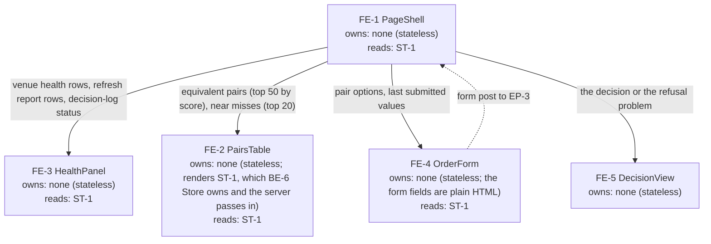
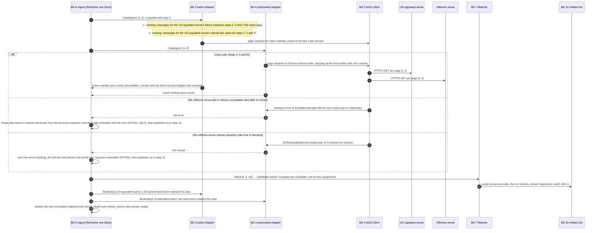
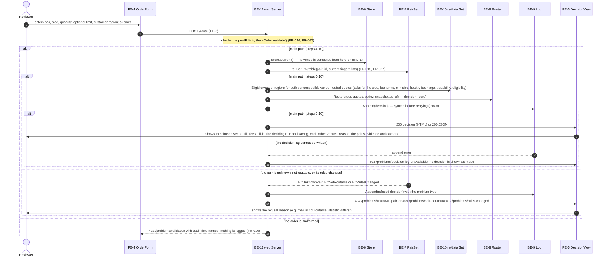
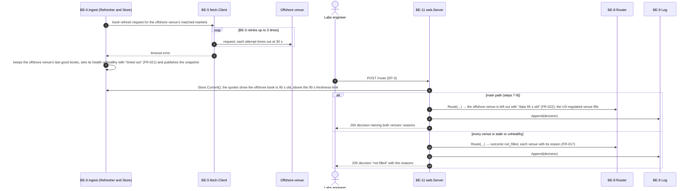
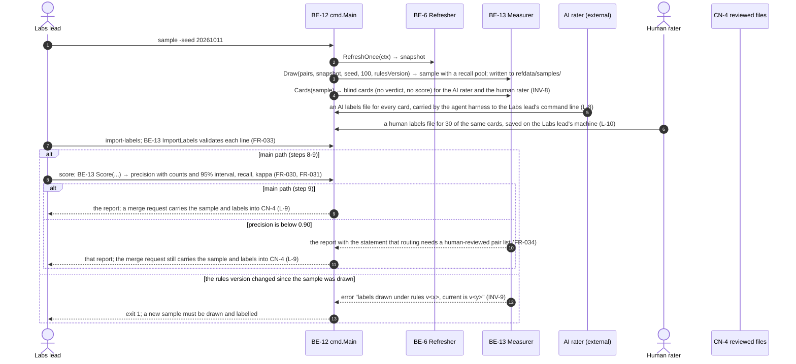
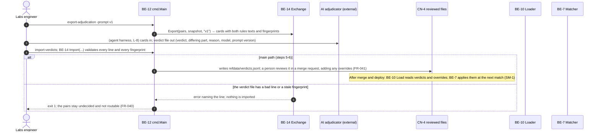
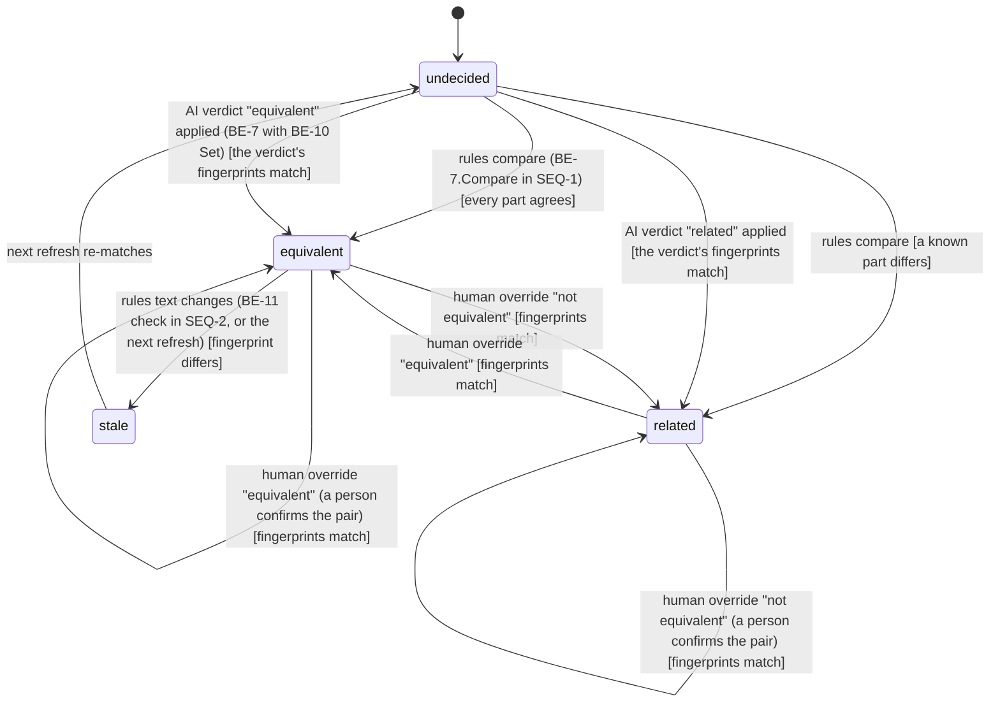
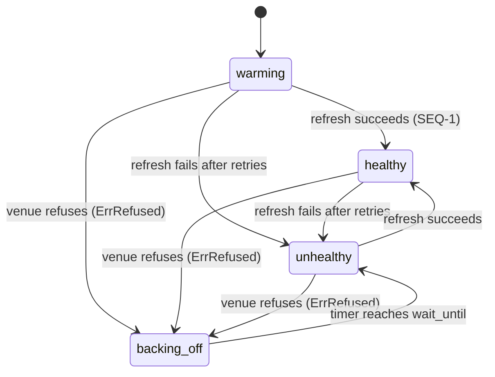

# Equinox — Low-level design

| Field | Value |
|---|---|
| HLD | `docs/architecture/hld.md` @ e74350c |
| PRD | `docs/product/prd.md` @ 40eb5d5 |
| UX | n/a — no `docs/design/` (map-ux-flows skipped; G1 approved without it, D12); the one page (FR-042) is designed here from FR-042 and AE-036 |
| Milestone | M4-M6 (M4 tracer bullet, M5 trust, M6 reach), one pass by the human's choice (TRACKER Approvals 2026-10-11 16:31 CDT) |
| Mode | greenfield — from `specs/M1-cross-venue-equivalence-routing/brief.md` ## Track |
| Pass | revise per G3 row 2026-10-11 17:10 CDT |
| Stack | Go 1.27 standard library only (D13); no database: in-memory snapshots, an append-only file log, reviewed files in git (D14, D15) |
| Contract | `docs/architecture/contracts/openapi.yaml` (OpenAPI 3.1) |
| Last updated | 2026-10-11 17:12 CDT |
| Written by | design-lld (Claude Code, claude-opus-5-5) |
| Approval | G3 — recorded in `.handoff/TRACKER.md ## Approvals` (never in this file); decisions in `docs/decisions/DECISION_JOURNAL.md` |

## Inputs read

| Path | Version (sha or date) | Used for |
|---|---|---|
| `docs/architecture/hld.md` | e74350c | containers CN-1..CN-4, connections, trust zones, INV-1..INV-9, §10 rules (money, time, errors, idempotency) |
| `docs/product/prd.md` | 40eb5d5 | scope FR-001..FR-043, stories US-1..US-7, AE and EC ids, assumptions A-1..A-8 |
| `AGENTS.md` | 7924a39 | conventions; stack open until G2 (now D13) |
| `docs/decisions/DECISION_JOURNAL.md` | a927085 | accepted D1-D18 as constraints; next id D19 |
| `docs/research/R01`, `R03`, `R04`, `R08` | c1c023e | venue record shapes and limits (R01, R08), settlement fields (R03), fee terms and rounding (R04) |
| Live checks of both venues' public listings | 2026-10-11 16:08 CDT | the offshore venue orders its listing by 24-hour volume; the US-regulated venue's market records carry a 24-hour volume field |

**Not read:** `docs/design/` — does not exist (UX phase skipped, G1 approved) · v1 code at main@9c3bf48 — not used as
input (D3).

## Requirement trace

| Requirement | Tables | Backend | Endpoints | Frontend / state | Journey | State machine |
|---|---|---|---|---|---|---|
| FR-001 | `markets`, `refresh_reports` | BE-3, BE-4, BE-5, BE-6 | — | — | SEQ-1 | SM-2 |
| FR-002 | `markets`, `books` | BE-1, BE-3, BE-4 | EP-2 | — | SEQ-1 | — |
| FR-003 | `refresh_reports` | BE-6 | EP-5 | FE-3 | SEQ-1 | — |
| FR-004 | `pairs` | BE-7 | EP-2 | FE-2 | SEQ-1 | SM-1 |
| FR-005 | `pairs` | BE-7 | EP-2 | FE-2 | SEQ-1 | SM-1 |
| FR-006 | `pairs` | BE-7 | EP-2 | FE-2 | SEQ-1 | SM-1 |
| FR-007 | `pairs` | BE-7 | EP-2 | FE-2 | SEQ-1 | — |
| FR-008 | `decisions` | BE-8, BE-11 | EP-3 | FE-4, FE-5 | SEQ-2 | — |
| FR-009 | `books`, `markets` | BE-1, BE-8 | EP-3 | FE-5 | SEQ-2 | — |
| FR-010 | `decisions` | BE-8 | EP-3 | FE-5 | SEQ-2 | — |
| FR-011 | `decisions` | BE-8 | EP-3 | FE-5 | SEQ-2 | — |
| FR-012 | `decisions` | BE-9, BE-11 | EP-3, EP-4 | — | SEQ-2 | — |
| FR-013 | `decisions` | BE-8 | EP-3 | — | SEQ-2 | — |
| FR-014 | — | BE-8 | EP-3 | — | SEQ-2 | — |
| FR-015 | `pairs` | BE-11 | EP-3 | FE-5 | SEQ-2 | SM-1 |
| FR-016 | — | BE-11 | EP-3 | FE-4 | SEQ-2 | — |
| FR-017 | `decisions` | BE-8 | EP-3 | FE-5 | SEQ-2 | — |
| FR-018 | `decisions` | BE-8 | EP-3 | FE-5 | SEQ-2 | — |
| FR-019 | `pairs`, `decisions` | BE-8, BE-11 | EP-3 | FE-5 | SEQ-2 | — |
| FR-020 | — | BE-6, BE-8, BE-11 | EP-3 | — | SEQ-3 | — |
| FR-021 | `venue_health` | BE-6 | EP-5 | FE-3 | SEQ-3 | SM-2 |
| FR-022 | `books` | BE-8 | EP-3 | FE-5 | SEQ-3 | — |
| FR-023 | `markets`, `books` | BE-1, BE-8 | EP-3 | FE-5 | SEQ-2 | — |
| FR-024 | `refresh_reports` | BE-3, BE-4 | EP-5 | FE-3 | SEQ-1 | — |
| FR-025 | `venue_health` | BE-5, BE-6 | EP-5 | FE-3 | SEQ-3 | SM-2 |
| FR-026 | `venue_health`, `refresh_reports` | BE-6, BE-11 | EP-5 | FE-3 | SEQ-3 | SM-2 |
| FR-027 | `pairs` | BE-7, BE-11 | EP-3 | FE-5 | SEQ-2 | SM-1 |
| FR-028 | `samples` | BE-13 | — | — | SEQ-4 | — |
| FR-029 | `samples` | BE-13 | — | — | SEQ-4 | — |
| FR-030 | `labels` | BE-13 | — | — | SEQ-4 | — |
| FR-031 | `labels` | BE-13 | — | — | SEQ-4 | — |
| FR-032 | `samples` | BE-13 | — | — | SEQ-4 | — |
| FR-033 | `labels` | BE-10, BE-13 | — | — | SEQ-4 | — |
| FR-034 | `labels` | BE-13 | — | — | SEQ-4 | — |
| FR-035 | `eligibility` | BE-10 | EP-5 | — | SEQ-2 | — |
| FR-036 | `eligibility` | BE-8 | EP-3 | FE-5 | SEQ-2 | — |
| FR-037 | — | BE-11 | EP-3 | FE-4 | SEQ-2 | — |
| FR-038 | `verdicts` | BE-14 | — | — | SEQ-5 | SM-1 |
| FR-039 | `verdicts` | BE-10, BE-14 | — | — | SEQ-5 | SM-1 |
| FR-040 | `refresh_reports` | BE-7 | EP-5 | FE-3 | SEQ-5 | SM-1 |
| FR-041 | `overrides` | BE-10, BE-7 | — | — | SEQ-5 | SM-1 |
| FR-042 | — | BE-11 | EP-1 | FE-1, FE-2, FE-3, FE-4, FE-5, ST-1 | SEQ-2 | — |
| FR-043 | — | BE-11, BE-12 | EP-6 | FE-3 | — | — |
| NFR-001 | `decisions` | BE-8 | — | — | SEQ-2 | — |
| NFR-002 | — | BE-8, BE-11 | EP-3 | — | SEQ-3 | — |
| NFR-003 | — | BE-5 | — | — | SEQ-1 | — |
| NFR-005 | `markets` | BE-1 | — | — | SEQ-2 | — |
| NFR-006 | `decisions` | BE-9 | EP-4 | — | SEQ-2 | — |

## 1. Data model

There is no database (D15). Each "table" below is one record shape: held in memory inside an immutable snapshot
(CN-1), appended to the decision log file (CN-2), or stored as a reviewed file in git (CN-4). Types are Go types.
"Constraint" names a rule the loader or constructor enforces before a record exists, so an invalid record is never
held. Money is `market.Amount`, an `int64` count of micro-dollars (one millionth of a US dollar); there is no
currency column because one winning contract pays $1 on either venue and payouts are treated as US dollars (A-2).
All times are `time.Time` in UTC (HLD §10 Time).

```mermaid
%% diagram: erd
%% source: docs/architecture/lld.md#1-data-model @ d7cc8b2
%% drawn: 2026-10-11T22:13:40Z by draw-diagrams (claude, claude-opus-5-5)
%% render: unverified
%% render-check: mmdc not on PATH
%% missing: 0
%% Generated from the source section. Do not edit by hand: fix the section, then re-run `draw-diagrams erd`.
%% Types: Go "pkg.Type" is drawn "pkg-Type" and "[]T" is drawn "T[]", because a Mermaid attribute type cannot hold "." or start with "[".
erDiagram
    markets ||--o| books : "market_key"
    markets ||..o{ pairs : "a_key"
    markets ||..o{ pairs : "b_key"
    pairs |o..o| verdicts : "pair_id + fingerprints"
    pairs |o..o| overrides : "pair_id + fingerprints"
    samples ||--o{ labels : "sample_id"
    pairs |o..o{ decisions : "order.pair_id (copied, not linked)"
    markets {
        market-Key key PK "not null · (string #lt;venue#gt;:#lt;venue id#gt;[:#lt;outcome index#gt;])"
        string venue "not null"
        string event_id "not null"
        string question "not null"
        string outcome "not null"
        string rules_text "not null"
        string rules_fingerprint "not null · (hex SHA-256 of rules_text + terms)"
        market-Terms terms "not null · (subject, predicate, threshold value and comparator, window start and end, source, statistic, edge rules)"
        string topic "not null"
        time-Time opens_at "not null"
        time-Time closes_at "not null"
        time-Time resolves_at "nullable"
        int64 volume_24h "not null · (contracts)"
        bool tradable "not null"
        string untradable_reason "nullable"
        market-FeeTerms fee "not null · (rate in parts per million, curve exponents, rounding unit in micro-dollars, per-order or per-fill rounding)"
        int64 min_qty "not null"
        string book_ref "not null"
        time-Time received_at "not null"
    }
    books {
        market-Key market_key PK, FK "not null · ref markets.key"
        market-Level[] bids "not null · (price Amount, quantity int64), best first"
        market-Level[] asks "not null · best first"
        time-Time as_of "not null"
        bool crossed "not null"
    }
    pairs {
        string pair_id PK "not null · (hex SHA-256 of the two keys in sorted order, first 16 chars)"
        market-Key a_key FK "not null · ref markets.key · uq_pairs_one_to_one: each market key appears in at most one equivalent pair"
        market-Key b_key FK "not null · ref markets.key · uq_pairs_one_to_one: each market key appears in at most one equivalent pair"
        string verdict "not null"
        string decided_by "not null"
        string differing_part "nullable"
        string[] evidence "not null"
        string[] caveats "not null"
        int64 score "not null · (similarity in parts per thousand)"
        string fingerprint_a "not null"
        string fingerprint_b "not null"
        string rules_version "not null"
        time-Time matched_at "not null"
    }
    venue_health {
        string venue PK "not null"
        string state "not null"
        time-Time last_good_at "nullable"
        string last_error "nullable"
        time-Time wait_until "nullable"
    }
    refresh_reports {
        string venue PK "not null"
        int64 listed "not null"
        int64 considered "not null"
        int64 inactive "not null"
        int64 too_short "not null"
        int64 unreadable "not null"
        int64 undecided_pairs "not null"
        time-Duration duration "not null"
        time-Time finished_at "not null"
    }
    %% decisions — Primary key: none (append-only log; position in the file orders it)
    decisions {
        string decision_id "not null · (hex SHA-256 of the canonical order + quotes + policy + snapshot time, first 16 chars)"
        time-Time logged_at "not null"
        string request_id "not null"
        route-Order order "not null · (pair id, side yes or no, quantity, optional limit Amount, customer region)"
        time-Time snapshot_as_of "not null"
        string outcome "not null"
        string venue "nullable"
        int64 filled_qty "not null"
        int64 unfilled_qty "not null"
        market-Amount avg_price "nullable"
        market-Amount fees "not null"
        market-Amount all_in "not null"
        string deciding_rule "nullable"
        market-Amount saving "nullable"
        route-VenueResult[] venues "not null · (venue, eligible, reason, filled, all-in)"
        string[] evidence "not null"
        string[] caveats "not null"
        string problem_type "nullable"
    }
    eligibility {
        string venue PK "not null"
        string[] regions "not null"
        string source "not null"
        string checked_on "not null · (date)"
    }
    verdicts {
        string pair_id PK "not null"
        string fingerprint_a PK "not null"
        string fingerprint_b PK "not null"
        string verdict "not null"
        string differing_part "nullable"
        string reason "not null"
        string model "not null"
        string prompt_version "not null"
        time-Time decided_at "not null"
    }
    overrides {
        string pair_id PK "not null"
        string fingerprint_a PK "not null"
        string fingerprint_b PK "not null"
        string verdict "not null"
        string note "nullable"
        time-Time decided_at "not null"
    }
    samples {
        string sample_id PK "not null · (#lt;date#gt;-#lt;seed#gt;)"
        uint64 seed "not null"
        string rules_version "not null"
        time-Time drawn_at "not null"
        string[] precision_pairs "not null · (pair ids)"
        string[] recall_pool "not null · (pair ids)"
        measure-Card[] cards "not null · (both questions and rules texts only)"
    }
    labels {
        string sample_id PK, FK "not null · ref samples.sample_id"
        string pair_id PK "not null"
        string rater PK "not null"
        string label "not null"
        time-Time labelled_at "not null"
        string rules_version "not null"
    }
```

<!-- diagram: erd -->

<!-- /diagram -->

### Tables

#### `markets` — one binary proposition on one venue (a multi-outcome listing becomes one row per outcome, D19) · owner BE-6 · new

| Column | Type | Null | Default | Constraint | Notes |
|---|---|---|---|---|---|
| `key` | `market.Key` (string `<venue>:<venue id>[:<outcome index>]`) | no | — | PK `pk_markets_key` | natural key from the venue |
| `venue` | `string` | no | — | CHECK `ck_markets_venue`: one of the configured venue ids | opaque to routing (INV-7) |
| `event_id` | `string` | no | — | — | venue's event or series grouping |
| `question` | `string` | no | — | CHECK `ck_markets_question_nonempty` | as the venue states it |
| `outcome` | `string` | no | `"Yes"` | — | the YES side's label for named-outcome listings |
| `rules_text` | `string` | no | — | — | full settlement rules; data, never instructions |
| `rules_fingerprint` | `string` (hex SHA-256 of `rules_text` + `terms`) | no | — | — | detects a rules change after matching (FR-027) |
| `terms` | `market.Terms` (subject, predicate, threshold value and comparator, window start and end, source, statistic, edge rules) | no | each part `unknown` until parsed | CHECK `ck_markets_terms_parts`: every part is a value or `unknown`, never blank | the comparable settlement parts (D20) |
| `topic` | `string` | no | `"other"` | CHECK `ck_markets_topic`: one of elections, economics, sports, crypto, other | the system's own topic labels (A-6) |
| `opens_at` | `time.Time` | no | — | — | |
| `closes_at` | `time.Time` | no | — | CHECK `ck_markets_life`: `closes_at - opens_at >= 1h` | sub-hour windows left out (FR-001, D11) |
| `resolves_at` | `time.Time` | yes | — | — | null when the venue gives no expected payout time; feeds the timing caveat (FR-005) |
| `volume_24h` | `int64` (contracts) | no | `0` | CHECK `ck_markets_active`: `> 0` | active-only rule (FR-001, D11) |
| `tradable` | `bool` | no | `true` | — | false when closed, paused or past its end (FR-023) |
| `untradable_reason` | `string` | yes | — | CHECK `ck_markets_untradable`: set iff `tradable` is false | shown in decisions |
| `fee` | `market.FeeTerms` (rate in parts per million, curve exponents, rounding unit in micro-dollars, per-order or per-fill rounding) | no | — | CHECK `ck_markets_fee_known`: every field set, else the market is untradable with reason "fee terms unknown" | fees as data (INV-3, NFR-005) |
| `min_qty` | `int64` | no | `1` | CHECK `ck_markets_min_qty`: `>= 1` | |
| `book_ref` | `string` | no | — | — | the id the venue's book service needs |
| `received_at` | `time.Time` | no | — | — | when the record arrived (SEAM-1 clock) |

- **Primary key:** `key` — the venue's own id, prefixed by venue, plus the outcome index for named-outcome listings
- **Foreign keys:** none (a snapshot is rebuilt whole each refresh)
- **Indexes:** `ix_markets_tokens` (rare normalized tokens of `question` + `outcome`) — serves BE-7 candidate search; `ix_markets_event` (`event_id`) — serves near-miss grouping (FR-007)
- **Unique:** `pk_markets_key` — a venue never lists the same key twice in one snapshot; a duplicate keeps the first and counts the second as unreadable (FR-024)
- **Checks:** `ck_markets_venue`, `ck_markets_question_nonempty`, `ck_markets_terms_parts`, `ck_markets_topic`, `ck_markets_life`, `ck_markets_active`, `ck_markets_untradable`, `ck_markets_fee_known`, `ck_markets_min_qty` — enforced by `market.NewMarket` before a record enters a snapshot
- **Sensitive data:** none (public market data)
- **Basis:** FR-001, FR-002, FR-023, FR-024, FR-027, HLD CN-1 data owned (market snapshots)

#### `books` — the YES side of one market's order book at receipt time · owner BE-6 · new

| Column | Type | Null | Default | Constraint | Notes |
|---|---|---|---|---|---|
| `market_key` | `market.Key` | no | — | PK `pk_books_market`; FK `fk_books_market` → `markets.key` | |
| `bids` | `[]market.Level` (price `Amount`, quantity `int64`), best first | no | empty | CHECK `ck_books_sorted`: strictly descending price, merged duplicates | a NO ask at price p is a YES bid at $1 − p (INV-3 exact) |
| `asks` | `[]market.Level`, best first | no | empty | CHECK `ck_books_sorted_asks`: strictly ascending price | |
| `as_of` | `time.Time` | no | — | CHECK `ck_books_dated`: not zero | receipt time, the freshness clock (FR-022) |
| `crossed` | `bool` | no | `false` | — | set when best bid ≥ best ask; such a book is never used (FR-023) |

- **Primary key:** `market_key`
- **Foreign keys:** `fk_books_market`: `market_key` → `markets.key` ON DELETE CASCADE — a book means nothing without its market
- **Indexes:** none beyond the key (looked up by key only)
- **Unique:** `pk_books_market`
- **Checks:** `ck_books_sorted`, `ck_books_sorted_asks`, `ck_books_dated` — enforced by `market.NewBook`
- **Sensitive data:** none
- **Basis:** FR-009, FR-022, FR-023, R01 (book shapes), R04 (YES/NO complement)

#### `pairs` — one proposed match between a market on each venue · owner BE-7 · new

| Column | Type | Null | Default | Constraint | Notes |
|---|---|---|---|---|---|
| `pair_id` | `string` (hex SHA-256 of the two keys in sorted order, first 16 chars) | no | — | PK `pk_pairs_id` | stable across refreshes while the keys stay the same |
| `a_key` | `market.Key` | no | — | FK `fk_pairs_a` → `markets.key` | the US-regulated venue's side is not special: keys sort by string |
| `b_key` | `market.Key` | no | — | FK `fk_pairs_b` → `markets.key` | |
| `verdict` | `string` | no | `"undecided"` | CHECK `ck_pairs_verdict`: `undecided`, `equivalent`, `related`, `stale` | state machine SM-1 |
| `decided_by` | `string` | no | `"rules"` | CHECK `ck_pairs_decided_by`: `rules`, `ai`, `human` | |
| `differing_part` | `string` | yes | — | CHECK `ck_pairs_differing`: set iff `verdict` is `related` | one of question, source, statistic, window, threshold, edge rule (FR-006) |
| `evidence` | `[]string` | no | empty | — | one line per agreeing part (FR-004) |
| `caveats` | `[]string` | no | empty | — | e.g. payout timing difference (FR-005) |
| `score` | `int64` (similarity in parts per thousand) | no | `0` | CHECK `ck_pairs_score`: 0..1000 | never shown to raters (INV-8) |
| `fingerprint_a` | `string` | no | — | — | `markets.rules_fingerprint` of `a_key` at matching time |
| `fingerprint_b` | `string` | no | — | — | same for `b_key` |
| `rules_version` | `string` | no | — | — | version of the matching rules that produced it (INV-9) |
| `matched_at` | `time.Time` | no | — | — | snapshot time |

- **Primary key:** `pair_id`
- **Foreign keys:** `fk_pairs_a`, `fk_pairs_b` → `markets.key` ON DELETE CASCADE — a pair vanishes when either market leaves the snapshot
- **Indexes:** `ix_pairs_verdict_score` (`verdict`, `score` DESC, `pair_id`) — serves EP-2 lists and near misses (FR-007)
- **Unique:** `uq_pairs_one_to_one`: each market key appears in at most one `equivalent` pair — greedy one-to-one assignment (D20)
- **Checks:** `ck_pairs_verdict`, `ck_pairs_decided_by`, `ck_pairs_differing`, `ck_pairs_score` — enforced by BE-7
- **Sensitive data:** none
- **Basis:** FR-004..FR-007, FR-015, FR-027, D7, HLD INV-4

#### `venue_health` — one row per venue, replaced each refresh · owner BE-6 · new

| Column | Type | Null | Default | Constraint | Notes |
|---|---|---|---|---|---|
| `venue` | `string` | no | — | PK `pk_venue_health` | |
| `state` | `string` | no | `"warming"` | CHECK `ck_venue_health_state`: `warming`, `healthy`, `backing_off`, `unhealthy` | state machine SM-2 |
| `last_good_at` | `time.Time` | yes | — | — | null until the first good refresh |
| `last_error` | `string` | yes | — | — | truncated to 500 characters |
| `wait_until` | `time.Time` | yes | — | CHECK `ck_venue_health_wait`: set iff `state` is `backing_off` | stated wait (FR-025) |

- **Primary key:** `venue`
- **Foreign keys:** none
- **Indexes:** none (two rows)
- **Unique:** `pk_venue_health`
- **Checks:** `ck_venue_health_state`, `ck_venue_health_wait` — enforced by BE-6
- **Sensitive data:** none
- **Basis:** FR-021, FR-025, FR-026

#### `refresh_reports` — counts from the latest refresh per venue · owner BE-6 · new

| Column | Type | Null | Default | Constraint | Notes |
|---|---|---|---|---|---|
| `venue` | `string` | no | — | PK `pk_refresh_reports` | |
| `listed` | `int64` | no | `0` | CHECK `ck_refresh_counts`: `listed = considered + inactive + too_short + unreadable` | FR-003 |
| `considered` | `int64` | no | `0` | — | |
| `inactive` | `int64` | no | `0` | — | no trade in 24 h |
| `too_short` | `int64` | no | `0` | — | life under 1 h |
| `unreadable` | `int64` | no | `0` | — | FR-024 |
| `undecided_pairs` | `int64` | no | `0` | — | pairs left for AI adjudication (FR-040) |
| `duration` | `time.Duration` | no | `0` | — | NFR-004 signal |
| `finished_at` | `time.Time` | no | — | — | |

- **Primary key:** `venue` · **Foreign keys:** none · **Indexes:** none · **Unique:** `pk_refresh_reports`
- **Checks:** `ck_refresh_counts` — enforced by BE-6 (a refresh whose counts do not add up is reported as an error)
- **Sensitive data:** none
- **Basis:** FR-003, FR-024, FR-040, NFR-004

#### `decisions` — one decided or refused order, one JSON line in the decision log file · owner BE-9 · new

| Column | Type | Null | Default | Constraint | Notes |
|---|---|---|---|---|---|
| `decision_id` | `string` (hex SHA-256 of the canonical order + quotes + policy + snapshot time, first 16 chars) | no | — | — | same inputs, same id (INV-2); not unique in the log: a repeated order is logged again (EC-9) |
| `logged_at` | `time.Time` | no | — | — | wall clock at append; not an input to the decision |
| `request_id` | `string` | no | — | — | correlation id |
| `order` | `route.Order` (pair id, side yes or no, quantity, optional limit `Amount`, customer region) | no | — | — | |
| `snapshot_as_of` | `time.Time` | no | — | — | the frozen data's time |
| `outcome` | `string` | no | — | CHECK `ck_decisions_outcome`: `filled`, `partial`, `not_filled`, `refused` | immutable once written; no lifecycle |
| `venue` | `string` | yes | — | CHECK `ck_decisions_venue`: set iff `outcome` is `filled` or `partial` | |
| `filled_qty` | `int64` | no | `0` | — | FR-018 |
| `unfilled_qty` | `int64` | no | `0` | CHECK `ck_decisions_qty`: `filled_qty + unfilled_qty = order quantity` | |
| `avg_price` | `market.Amount` | yes | — | — | |
| `fees` | `market.Amount` | no | `0` | — | |
| `all_in` | `market.Amount` | no | `0` | — | notional + fees |
| `deciding_rule` | `string` | yes | — | CHECK `ck_decisions_rule`: `most_filled`, `lowest_all_in`, `tie_break`, `only_eligible` | FR-010 |
| `saving` | `market.Amount` | yes | — | — | against the next-best venue |
| `venues` | `[]route.VenueResult` (venue, eligible, reason, filled, all-in) | no | — | — | why each venue lost or was left out (FR-011) |
| `evidence` | `[]string` | no | empty | — | copied from the pair (FR-019) |
| `caveats` | `[]string` | no | empty | — | copied from the pair (FR-019) |
| `problem_type` | `string` | yes | — | CHECK `ck_decisions_problem`: set iff `outcome` is `refused` | a §4 registry path |

- **Primary key:** none (append-only log; position in the file orders it) · **Foreign keys:** none (the snapshot is gone after the next refresh; the line carries what it needs)
- **Indexes:** none: EP-4 reads the file newest first
- **Unique:** none
- **Checks:** `ck_decisions_outcome`, `ck_decisions_venue`, `ck_decisions_qty`, `ck_decisions_rule`, `ck_decisions_problem` — enforced by `route.Decision` construction
- **Sensitive data:** none (no identity is recorded)
- **Basis:** FR-008..FR-019, FR-012, NFR-006, HLD INV-6

#### `eligibility` — which customer regions may use each venue · reviewed file `refdata/eligibility.json` · owner BE-10 · new

| Column | Type | Null | Default | Constraint | Notes |
|---|---|---|---|---|---|
| `venue` | `string` | no | — | PK `pk_eligibility` | |
| `regions` | `[]string` | no | — | CHECK `ck_eligibility_regions`: non-empty; each one of `US`, `non-US` | |
| `source` | `string` | no | — | CHECK `ck_eligibility_source`: non-empty | where the status was read (R06) |
| `checked_on` | `string` (date) | no | — | — | A-4 |

- **Primary key:** `venue` · **Foreign keys:** none · **Indexes:** none · **Unique:** `pk_eligibility`
- **Checks:** `ck_eligibility_regions`, `ck_eligibility_source` — BE-10 refuses to start the service when a venue has no row (HLD L-5)
- **Sensitive data:** none
- **Basis:** FR-035, FR-036, A-4, HLD INV-5

#### `verdicts` — AI adjudications of pairs the rules left undecided · reviewed file `refdata/verdicts.jsonl` · owner BE-14 · new

| Column | Type | Null | Default | Constraint | Notes |
|---|---|---|---|---|---|
| `pair_id` | `string` | no | — | PK `pk_verdicts_pair_fp` with the two fingerprints | |
| `fingerprint_a` | `string` | no | — | — | a verdict applies only while both rules texts are unchanged (FR-027) |
| `fingerprint_b` | `string` | no | — | — | same, for the other market |
| `verdict` | `string` | no | — | CHECK `ck_verdicts_value`: `equivalent`, `related` | |
| `differing_part` | `string` | yes | — | set iff `related` | |
| `reason` | `string` | no | — | CHECK `ck_verdicts_reason`: non-empty | FR-039 |
| `model` | `string` | no | — | non-empty | FR-039 |
| `prompt_version` | `string` | no | — | non-empty | FR-039 |
| `decided_at` | `time.Time` | no | — | — | |

- **Primary key:** (`pair_id`, `fingerprint_a`, `fingerprint_b`) · **Foreign keys:** none (pairs are rebuilt; the match is by id and fingerprints) · **Indexes:** in-memory map by primary key · **Unique:** the primary key
- **Checks:** `ck_verdicts_value`, `ck_verdicts_reason` and non-empty `model` and `prompt_version` — BE-14 rejects the whole import file on any failure
- **Sensitive data:** none
- **Basis:** FR-038, FR-039, D10, D16

#### `overrides` — a person's accept or reject of an AI verdict · reviewed file `refdata/overrides.jsonl` · owner BE-10 · new

| Column | Type | Null | Default | Constraint | Notes |
|---|---|---|---|---|---|
| `pair_id` | `string` | no | — | PK `pk_overrides` with the fingerprints | |
| `fingerprint_a` | `string` | no | — | — | |
| `fingerprint_b` | `string` | no | — | — | |
| `verdict` | `string` | no | — | CHECK `ck_overrides_value`: `equivalent`, `not_equivalent` | wins over the AI verdict (FR-041) |
| `note` | `string` | yes | — | — | the person's reason |
| `decided_at` | `time.Time` | no | — | — | |

- **Primary key:** (`pair_id`, `fingerprint_a`, `fingerprint_b`) · **Foreign keys:** none · **Indexes:** in-memory map · **Unique:** the primary key
- **Checks:** `ck_overrides_value` — BE-10
- **Sensitive data:** none (no names; the merge request records who)
- **Basis:** FR-041

#### `samples` — one measurement draw · reviewed file `refdata/samples/<sample_id>.json` · owner BE-13 · new

| Column | Type | Null | Default | Constraint | Notes |
|---|---|---|---|---|---|
| `sample_id` | `string` (`<date>-<seed>`) | no | — | PK `pk_samples` | |
| `seed` | `uint64` | no | — | — | FR-028 |
| `rules_version` | `string` | no | — | — | INV-9 |
| `drawn_at` | `time.Time` | no | — | — | |
| `precision_pairs` | `[]string` (pair ids) | no | — | CHECK `ck_samples_size`: 1..100 | up to 100 `equivalent` pairs (FR-028) |
| `recall_pool` | `[]string` (pair ids) | no | — | — | near misses + random same-topic candidates (FR-032) |
| `cards` | `[]measure.Card` (both questions and rules texts only) | no | — | CHECK `ck_samples_blind`: no verdict, score or evidence field exists in the type | INV-8 |

- **Primary key:** `sample_id` · **Foreign keys:** none · **Indexes:** none · **Unique:** `pk_samples`
- **Checks:** `ck_samples_size`, `ck_samples_blind` (a compile-time property of `measure.Card`, proven by a test)
- **Sensitive data:** none
- **Basis:** FR-028, FR-029, FR-032, D9

#### `labels` — one rater's label for one card · reviewed file `refdata/labels/<sample_id>.jsonl` · owner BE-13 · new

| Column | Type | Null | Default | Constraint | Notes |
|---|---|---|---|---|---|
| `sample_id` | `string` | no | — | FK `fk_labels_sample` → `samples.sample_id` | |
| `pair_id` | `string` | no | — | must appear in that sample | |
| `rater` | `string` | no | — | CHECK `ck_labels_rater`: `ai`, `human` | a role, never a name |
| `label` | `string` | no | — | CHECK `ck_labels_value`: `equivalent`, `not_equivalent` | A-5 |
| `labelled_at` | `time.Time` | no | — | — | |
| `rules_version` | `string` | no | — | — | copied from the sample (FR-033) |

- **Primary key:** (`sample_id`, `pair_id`, `rater`) `pk_labels`
- **Foreign keys:** `fk_labels_sample` ON DELETE RESTRICT — labels are evidence and are never orphaned
- **Indexes:** none · **Unique:** `pk_labels` (one label per rater per pair)
- **Checks:** `ck_labels_rater`, `ck_labels_value` — BE-13 rejects the import file on any failure
- **Sensitive data:** none
- **Basis:** FR-030, FR-031, FR-033, D9

### Relationships

| From | To | Cardinality | Via | Required? | Basis |
|---|---|---|---|---|---|
| `markets` | `books` | 1 — 0..1 | `books.market_key` | a market may have no book yet; it is then not routable | FR-009, FR-023 |
| `markets` | `pairs` | 1 — 0..N (at most 1 `equivalent`) | `pairs.a_key`, `pairs.b_key` | no | FR-004, D20 |
| `pairs` | `verdicts` | 0..1 — 0..1 per fingerprint pair (a verdict outlives its pair across refreshes) | `pair_id` + fingerprints | no | FR-038, FR-039 |
| `pairs` | `overrides` | 0..1 — 0..1 per fingerprint pair (an override outlives its pair across refreshes) | `pair_id` + fingerprints | no | FR-041 |
| `samples` | `labels` | 1 — 0..N | `labels.sample_id` | a score needs every card labelled by the AI rater and 30 by the human | FR-030, FR-031 |
| `pairs` | `decisions` | 0..1 — 0..N (a logged decision outlives its pair) | `decisions.order.pair_id` (copied, not linked) | no | FR-012 |

### Invariants the database enforces

There is no database engine; the constructors and loaders below are the strongest rung available (D15), each proven
by a unit test that tries to build an invalid record.

| Constraint | Table | Enforces | Engine note |
|---|---|---|---|
| `ck_markets_fee_known` | `markets` | INV-3 (fees as data, never guessed) | `market.NewMarket`; unknown fee terms make the market untradable |
| `ck_books_sorted`, `ck_books_dated` | `books` | INV-3, FR-023 | `market.NewBook` |
| `uq_pairs_one_to_one` | `pairs` | INV-4 (one bet maps to one bet) | BE-7 greedy assignment; test with crafted ties |
| `ck_decisions_qty`, `ck_decisions_problem` | `decisions` | INV-6 (a log line is complete) | `route.Decision` construction |
| `ck_eligibility_regions` | `eligibility` | INV-5 | BE-10 refuses to start without a row per venue |
| `ck_samples_blind` | `samples` | INV-8 | the `measure.Card` type has no verdict or score field |

## 2. Backend components

```mermaid
%% diagram: be-class
%% source: docs/architecture/lld.md#2-backend-components @ d7cc8b2
%% drawn: 2026-10-11T22:13:44Z by draw-diagrams (claude, claude-opus-5-5)
%% render: unverified
%% render-check: mmdc not on PATH
%% missing: 2
%% Generated from the source section. Do not edit by hand: fix the section, then re-run `draw-diagrams be-class`.
classDiagram
    class BE1["BE-1 market.Types"]
    BE1 : <<package internal/market>>
    BE1 : +ParseAmount(s string) (Amount, error)
    BE1 : +NewMarket(f MarketFields) (Market, error)
    BE1 : +NewBook(key Key, bids, asks []Level, asOf time.Time) (Book, error)
    BE1 : +(f FeeTerms) TakerFee(qty int64, price Amount) Amount
    BE1 : +(b Book) AsksFor(side Side) []Level
    note for BE1 "depends on: standard library only"

    class BE2["BE-2 venue.Venue"]
    BE2 : <<port (interface) · package internal/venue>>
    BE2 : +Name() string
    BE2 : +Catalog(ctx context.Context) ([]market.Market, CatalogStats, error)
    BE2 : +Books(ctx context.Context, keys []market.Key) (map[market.Key]market.Book, error)

    class BE3["BE-3 kalshi.Adapter"]
    BE3 : <<package internal/venues/kalshi>>
    BE3 : +New(c *fetch.Client, base string, now func() time.Time) *Adapter
    BE3 : +(a *Adapter) Name() string
    %% ⚠ missing: signatures of BE-3 Catalog and Books (the row names them without a signature, Returns "as BE-2") — docs/architecture/lld.md#2-backend-components does not state it

    class BE4["BE-4 polymarket.Adapter"]
    BE4 : <<package internal/venues/polymarket>>
    BE4 : +New(c *fetch.Client, catalogBase, bookBase string, now func() time.Time) *Adapter
    BE4 : +(a *Adapter) Name() string
    %% ⚠ missing: signatures of BE-4 Catalog and Books (the row names them without a signature, Returns "as BE-2") — docs/architecture/lld.md#2-backend-components does not state it

    class BE5["BE-5 fetch.Client"]
    BE5 : <<package internal/fetch>>
    BE5 : +New(t http.RoundTripper, perHost rate, timeout time.Duration, retries int, now func() time.Time) *Client
    BE5 : +(c *Client) GetJSON(ctx context.Context, url string, out any) error
    BE5 : +(c *Client) PostJSON(ctx context.Context, url string, body, out any) error
    BE5 : +NewRecorder(dir string, mode RecordMode, next http.RoundTripper) http.RoundTripper
    note for BE5 "depends on: net/http#59; SEAM-2 transport#59; SEAM-1 clock"

    class BE6["BE-6 ingest.Refresher and ingest.Store"]
    BE6 : <<package internal/ingest>>
    BE6 : +NewStore() *Store
    BE6 : +(s *Store) Current() (*Snapshot, bool)
    BE6 : +NewRefresher(venues []venue.Venue, m *match.Matcher, ref refdata.Set, s *Store, cfg Cadence, now func() time.Time) *Refresher
    BE6 : +(r *Refresher) Run(ctx context.Context) error
    BE6 : +(r *Refresher) RefreshOnce(ctx context.Context) (*Snapshot, error)
    note for BE6 "depends on: SEAM-1 clock"

    class BE7["BE-7 match.Matcher"]
    BE7 : <<package internal/match>>
    BE7 : +New(rulesVersion string) *Matcher
    BE7 : +(m *Matcher) Match(a, b []market.Market, ref refdata.Set) PairSet
    BE7 : +Compare(x, y market.Market) Verdict
    BE7 : +(p PairSet) Routable(id string, cur map[market.Key]string) (Pair, error)

    class BE8["BE-8 route.Router"]
    BE8 : <<package internal/route>>
    BE8 : +Route(o Order, quotes []Quote, p Policy, asOf time.Time) Decision
    BE8 : +(o Order) Validate() error

    class BE9["BE-9 decisionlog.Log"]
    BE9 : <<package internal/decisionlog>>
    BE9 : +Open(path string) (*Log, error)
    BE9 : +(l *Log) Append(d route.Decision) error
    BE9 : +(l *Log) Page(cursor string, limit int) ([]route.Decision, string, error)
    note for BE9 "depends on: os (SEAM-3 file)"

    class BE10["BE-10 refdata.Loader"]
    BE10 : <<package internal/refdata>>
    BE10 : +Load(dir string, venues []string) (Set, error)
    BE10 : +(s Set) Eligible(venue, region string) (bool, string)
    note for BE10 "depends on: os"

    class BE11["BE-11 web.Server"]
    BE11 : <<package internal/web>>
    BE11 : +New(s *ingest.Store, l *decisionlog.Log, ref refdata.Set, lim *RateLimiter, version string) *Server
    BE11 : +(s *Server) Handler() http.Handler
    BE11 : +(s *Server) Index(w http.ResponseWriter, r *http.Request)
    BE11 : +(s *Server) Pairs(w http.ResponseWriter, r *http.Request)
    BE11 : +(s *Server) Route(w http.ResponseWriter, r *http.Request)
    BE11 : +(s *Server) Decisions(w http.ResponseWriter, r *http.Request)
    BE11 : +(s *Server) Health(w http.ResponseWriter, r *http.Request)
    BE11 : +(s *Server) Version(w http.ResponseWriter, r *http.Request)
    note for BE11 "depends on: html/template, a per-IP limiter"

    class BE12["BE-12 cmd.Main"]
    BE12 : <<package cmd/equinox>>
    BE12 : +main()

    class BE13["BE-13 measure.Measurer"]
    BE13 : <<package internal/measure>>
    BE13 : +Draw(ps match.PairSet, snap *ingest.Snapshot, seed uint64, n int, rulesVersion string) Sample
    BE13 : +Cards(s Sample, snap *ingest.Snapshot) []Card
    BE13 : +ImportLabels(s Sample, r io.Reader) ([]Label, error)
    BE13 : +Score(s Sample, labels []Label, currentRules string) (Report, error)
    note for BE13 "depends on: math/rand/v2 (SEAM-4)"

    class BE14["BE-14 adjudicate.Exchange"]
    BE14 : <<package internal/adjudicate>>
    BE14 : +Export(ps match.PairSet, snap *ingest.Snapshot, promptVersion string) []measure.Card
    BE14 : +Import(r io.Reader, ps match.PairSet) ([]refdata.Verdict, error)

    BE2 <|.. BE3
    BE2 <|.. BE4
    BE2 ..> BE1 : depends on
    BE3 ..> BE5 : depends on
    BE3 ..> BE1 : depends on
    BE4 ..> BE5 : depends on
    BE4 ..> BE1 : depends on
    BE6 ..> BE2 : depends on
    BE6 ..> BE7 : depends on
    BE6 ..> BE10 : depends on
    BE7 ..> BE1 : depends on
    BE7 ..> BE10 : depends on
    BE8 ..> BE1 : depends on
    BE9 ..> BE8 : depends on
    BE10 ..> BE1 : depends on
    BE11 ..> BE6 : depends on
    BE11 ..> BE7 : depends on
    BE11 ..> BE8 : depends on
    BE11 ..> BE9 : depends on
    BE11 ..> BE10 : depends on
    BE12 ..> BE1 : depends on
    BE12 ..> BE2 : depends on
    BE12 ..> BE3 : depends on
    BE12 ..> BE4 : depends on
    BE12 ..> BE5 : depends on
    BE12 ..> BE6 : depends on
    BE12 ..> BE7 : depends on
    BE12 ..> BE8 : depends on
    BE12 ..> BE9 : depends on
    BE12 ..> BE10 : depends on
    BE12 ..> BE11 : depends on
    BE12 ..> BE13 : depends on
    BE12 ..> BE14 : depends on
    BE13 ..> BE1 : depends on
    BE13 ..> BE6 : depends on
    BE13 ..> BE7 : depends on
    BE14 ..> BE1 : depends on
    BE14 ..> BE6 : depends on
    BE14 ..> BE7 : depends on
    BE14 ..> BE10 : depends on
    BE14 ..> BE13 : depends on
```

<!-- diagram: be-class -->

<!-- /diagram -->

**Layering:** `cmd/equinox` (BE-12) wires everything; `web` (BE-11) translates HTTP; `ingest` (BE-6) owns snapshots;
`match` (BE-7) and `route` (BE-8) are pure functions over `market` (BE-1) types; venue adapters (BE-3, BE-4) are the
only code that knows a venue; `fetch` (BE-5) is the only HTTP client. `route` imports only `market` (INV-1, INV-7).

### BE-1 market.Types · package `internal/market` · CN-1, CN-3 · new

- **Responsibility:** define the venue-neutral market, book, fee and money types and their validating constructors.
- **Depends on:** standard library only
- **Tables:** defines `markets`, `books` shapes · **Transactions:** none
- **Basis:** FR-002, FR-009, FR-023, NFR-005, HLD INV-3

| Public method (signature only) | Called by | Returns | Raises (problem type) | Covers |
|---|---|---|---|---|
| `ParseAmount(s string) (Amount, error)` | BE-3, BE-4 | exact micro-dollars; rejects more than 6 decimals and overflow | none (error → record skipped) | INV-3 |
| `NewMarket(f MarketFields) (Market, error)` | BE-3, BE-4 | a validated market | none (error → record skipped, FR-024) | FR-002 |
| `NewBook(key Key, bids, asks []Level, asOf time.Time) (Book, error)` | BE-3, BE-4 | a sorted, merged book with `Crossed` set | none | FR-023 |
| `(f FeeTerms) TakerFee(qty int64, price Amount) Amount` | BE-8 | the venue's fee, rounded as published | none | FR-009, NFR-005 |
| `(b Book) AsksFor(side Side) []Level` | BE-8 | YES asks, or NO asks derived from YES bids at $1 − p | none | FR-009 |

### BE-2 venue.Venue · port (interface) · package `internal/venue` · CN-1, CN-3 · new

- **Responsibility:** state the one contract every venue adapter fulfils (two implementations: BE-3, BE-4; also the SEAM-2 swap point).
- **Depends on:** BE-1
- **Tables:** none · **Transactions:** none
- **Basis:** FR-014, JS-06, HLD INV-7

| Public method (signature only) | Called by | Returns | Raises (problem type) | Covers |
|---|---|---|---|---|
| `Name() string` | BE-6 | the venue id used in keys | none | FR-002 |
| `Catalog(ctx context.Context) ([]market.Market, CatalogStats, error)` | BE-6 | active markets plus listed, inactive, too-short, unreadable counts | none (error → health) | FR-001, FR-003, FR-024 |
| `Books(ctx context.Context, keys []market.Key) (map[market.Key]market.Book, error)` | BE-6 | books for the given markets; partial results allowed | none | FR-009 |

### BE-3 kalshi.Adapter · package `internal/venues/kalshi` · CN-1, CN-3 · new

- **Responsibility:** read the US-regulated venue's open markets, series fee terms and order books into BE-1 types.
- **Depends on:** BE-5, BE-1
- **Tables:** produces `markets`, `books` rows · **Transactions:** none
- **Basis:** FR-001, FR-002, R01, R04, R08 (127 pages of 1,000 open markets)

| Public method (signature only) | Called by | Returns | Raises (problem type) | Covers |
|---|---|---|---|---|
| `New(c *fetch.Client, base string, now func() time.Time) *Adapter` | BE-12 | an adapter | none | — |
| `(a *Adapter) Name() string`, `Catalog`, `Books` | BE-6 via BE-2 | as BE-2 | none | FR-001, FR-002, FR-024 |

### BE-4 polymarket.Adapter · package `internal/venues/polymarket` · CN-1, CN-3 · new

- **Responsibility:** read the offshore venue's open markets in 24-hour-volume order, its fee schedules and its order books into BE-1 types.
- **Depends on:** BE-5, BE-1
- **Tables:** produces `markets`, `books` rows · **Transactions:** none
- **Basis:** FR-001, FR-002, R01, R04, live check 2026-10-11 (volume ordering)

| Public method (signature only) | Called by | Returns | Raises (problem type) | Covers |
|---|---|---|---|---|
| `New(c *fetch.Client, catalogBase, bookBase string, now func() time.Time) *Adapter` | BE-12 | an adapter | none | — |
| `(a *Adapter) Name() string`, `Catalog`, `Books` | BE-6 via BE-2 | as BE-2; `Catalog` stops at the first market with zero 24-hour volume and de-duplicates by id | none | FR-001, FR-002, FR-024 |

### BE-5 fetch.Client · package `internal/fetch` · CN-1, CN-3 · new

- **Responsibility:** make every outbound HTTPS request with per-host pacing, timeouts, bounded retries and honoured waits.
- **Depends on:** `net/http`; SEAM-2 transport; SEAM-1 clock
- **Tables:** none · **Transactions:** none
- **Basis:** NFR-003, FR-021, FR-025, D17, R08 F16

| Public method (signature only) | Called by | Returns | Raises (problem type) | Covers |
|---|---|---|---|---|
| `New(t http.RoundTripper, perHost rate, timeout time.Duration, retries int, now func() time.Time) *Client` | BE-12 | a client | none | NFR-003 |
| `(c *Client) GetJSON(ctx context.Context, url string, out any) error` | BE-3, BE-4 | nil, `ErrRefused{Wait}`, `ErrMalformed` or a transport error | none | FR-021, FR-025 |
| `(c *Client) PostJSON(ctx context.Context, url string, body, out any) error` | BE-4 | as above | none | FR-009 |
| `NewRecorder(dir string, mode RecordMode, next http.RoundTripper) http.RoundTripper` | BE-12 | a transport that records or replays responses (D17) | none | SEAM-2 |

### BE-6 ingest.Refresher and ingest.Store · package `internal/ingest` · CN-1, CN-3 · new

- **Responsibility:** run refreshes on a cadence and publish each result as one immutable snapshot.
- **Depends on:** BE-2 (both venues), BE-7, BE-10, SEAM-1 clock
- **Tables:** writes `markets`, `books`, `pairs` (via BE-7), `venue_health`, `refresh_reports` into a new snapshot
- **Transactions:** none; `publish` is one atomic pointer swap, so a reader sees the whole old or the whole new snapshot
- **Basis:** FR-001, FR-003, FR-020, FR-021, FR-025, FR-026, D14

| Public method (signature only) | Called by | Returns | Raises (problem type) | Covers |
|---|---|---|---|---|
| `NewStore() *Store` | BE-12 | an empty store (warming) | none | — |
| `(s *Store) Current() (*Snapshot, bool)` | BE-11 | the latest snapshot; false while warming | none | FR-020 |
| `NewRefresher(venues []venue.Venue, m *match.Matcher, ref refdata.Set, s *Store, cfg Cadence, now func() time.Time) *Refresher` | BE-12 | a refresher | none | — |
| `(r *Refresher) Run(ctx context.Context) error` | BE-12 | runs until the context ends | none | FR-001, FR-025 |
| `(r *Refresher) RefreshOnce(ctx context.Context) (*Snapshot, error)` | BE-12 (CLI), tests | the published snapshot | none | FR-001..FR-007 |

### BE-7 match.Matcher · package `internal/match` · CN-1, CN-3 · new

- **Responsibility:** turn two venues' markets into one-to-one pairs with a verdict, evidence and caveats.
- **Depends on:** BE-1, BE-10 (verdicts, overrides, rules version)
- **Tables:** writes `pairs` · **Transactions:** none
- **Basis:** FR-004..FR-007, FR-027, FR-040, FR-041, D7, D19, D20

| Public method (signature only) | Called by | Returns | Raises (problem type) | Covers |
|---|---|---|---|---|
| `New(rulesVersion string) *Matcher` | BE-12 | a matcher | none | INV-9 |
| `(m *Matcher) Match(a, b []market.Market, ref refdata.Set) PairSet` | BE-6 | equivalent, related and undecided pairs, plus near misses, in a fixed order | none | FR-004..FR-007 |
| `Compare(x, y market.Market) Verdict` | BE-7, BE-13, tests | verdict, differing part, evidence, caveats, score for one pair | none | FR-004, FR-005, FR-006 |
| `(p PairSet) Routable(id string, cur map[market.Key]string) (Pair, error)` | BE-11 | the pair if it is `equivalent` and both fingerprints still match | `ErrUnknownPair`, `ErrNotRoutable`, `ErrRulesChanged` | FR-015, FR-027 |

### BE-8 route.Router · package `internal/route` · CN-1, CN-3 · new

- **Responsibility:** decide one hypothetical order from venue-neutral quotes as a pure function.
- **Depends on:** BE-1 only (INV-1, INV-7)
- **Tables:** none (produces a `decisions` record) · **Transactions:** none
- **Basis:** FR-008..FR-011, FR-013, FR-014, FR-017, FR-018, FR-022, FR-023, FR-036, D14

| Public method (signature only) | Called by | Returns | Raises (problem type) | Covers |
|---|---|---|---|---|
| `Route(o Order, quotes []Quote, p Policy, asOf time.Time) Decision` | BE-11, BE-12 | outcome, chosen venue, fill, fees, all-in, deciding rule, saving, per-venue results; never an error | none (a malformed order is rejected before this call) | FR-008..FR-011, FR-013, FR-017, FR-018 |
| `(o Order) Validate() error` | BE-11 | nil or the list of invalid fields | `/problems/validation` (via BE-11) | FR-016, FR-037 |

### BE-9 decisionlog.Log · package `internal/decisionlog` · CN-1, CN-2 · new

- **Responsibility:** append each decision as one durable JSON line and read pages back newest first.
- **Depends on:** `os` (SEAM-3 file), BE-8 (the `route.Decision` type it stores)
- **Tables:** writes and reads `decisions`
- **Transactions:** `Append` writes the whole line and syncs it to disk before returning (INV-6)
- **Basis:** FR-012, NFR-006, D15

| Public method (signature only) | Called by | Returns | Raises (problem type) | Covers |
|---|---|---|---|---|
| `Open(path string) (*Log, error)` | BE-12 | an open log | none (error stops the service) | NFR-006 |
| `(l *Log) Append(d route.Decision) error` | BE-11, BE-12 | nil once the line is synced | `/problems/decision-log-unavailable` (via BE-11) | FR-012 |
| `(l *Log) Page(cursor string, limit int) ([]route.Decision, string, error)` | BE-11 | one page newest first and the next cursor | `/problems/validation` (bad cursor) | FR-012 |

### BE-10 refdata.Loader · package `internal/refdata` · CN-1, CN-3, CN-4 · new

- **Responsibility:** load and validate the reviewed reference files into one immutable set.
- **Depends on:** `os`, BE-1
- **Tables:** reads `eligibility`, `verdicts`, `overrides`, `labels` · **Transactions:** none
- **Basis:** FR-033, FR-035, FR-039, FR-041, HLD L-5

| Public method (signature only) | Called by | Returns | Raises (problem type) | Covers |
|---|---|---|---|---|
| `Load(dir string, venues []string) (Set, error)` | BE-12 | eligibility, verdicts, overrides, rules version; an error names the bad file and line | none (error stops the service) | FR-035, FR-039, FR-041 |
| `(s Set) Eligible(venue, region string) (bool, string)` | BE-11 | allowed or not, with the reason text | none | FR-036 |

### BE-11 web.Server · package `internal/web` · CN-1 · new

- **Responsibility:** translate HTTP requests into snapshot reads, routing calls and log appends, and render the page.
- **Depends on:** BE-6 Store, BE-7 PairSet, BE-8, BE-9, BE-10, `html/template`, a per-IP limiter
- **Tables:** reads snapshot rows; appends `decisions` via BE-9 · **Transactions:** none
- **Basis:** FR-008, FR-012, FR-015, FR-016, FR-019, FR-026, FR-037, FR-042, FR-043, HLD TH-1, TH-2

| Public method (signature only) | Called by | Returns | Raises (problem type) | Covers |
|---|---|---|---|---|
| `New(s *ingest.Store, l *decisionlog.Log, ref refdata.Set, lim *RateLimiter, version string) *Server` | BE-12 | a server | none | — |
| `(s *Server) Handler() http.Handler` | BE-12 | the mux for EP-1..EP-6 | none | FR-042 |
| `(s *Server) Index(w http.ResponseWriter, r *http.Request)` | EP-1 | HTML page | `/problems/warming-up` | FR-042 |
| `(s *Server) Pairs(w http.ResponseWriter, r *http.Request)` | EP-2 | JSON page of pairs | `/problems/validation`, `/problems/warming-up` | FR-004..FR-007 |
| `(s *Server) Route(w http.ResponseWriter, r *http.Request)` | EP-3 | JSON or HTML decision | `/problems/validation`, `/problems/unknown-pair`, `/problems/pair-not-routable`, `/problems/rules-changed`, `/problems/warming-up`, `/problems/decision-log-unavailable`, `/problems/rate-limited` | FR-008, FR-015, FR-016, FR-027, FR-037 |
| `(s *Server) Decisions(w http.ResponseWriter, r *http.Request)` | EP-4 | JSON page of decisions | `/problems/validation` | FR-012 |
| `(s *Server) Health(w http.ResponseWriter, r *http.Request)` | EP-5 | JSON health | none | FR-003, FR-026 |
| `(s *Server) Version(w http.ResponseWriter, r *http.Request)` | EP-6 | JSON version | none | FR-043 |

### BE-12 cmd.Main · package `cmd/equinox` · CN-1, CN-3 · new

- **Responsibility:** parse the command line and wire components for each command.
- **Depends on:** every other BE (BE-1..BE-11, BE-13, BE-14)
- **Tables:** none · **Transactions:** none
- **Basis:** FR-043, US-4, US-6, D14, D17

| Public method (signature only) | Called by | Returns | Raises (problem type) | Covers |
|---|---|---|---|---|
| `main()` with commands `serve`, `refresh` (`-record dir` / `-replay dir`), `pairs`, `route`, `decisions`, `sample`, `cards`, `import-labels`, `score`, `export-adjudication`, `import-verdicts` | a person, Railway | exit code 0, or 1 with the reason on stderr | none | FR-043, US-4, US-6 |

### BE-13 measure.Measurer · package `internal/measure` · CN-3 · new

- **Responsibility:** draw seeded samples, produce blind cards and score labels into a measurement report.
- **Depends on:** BE-1, BE-6 (`*ingest.Snapshot`), BE-7 (`Compare` for the recall pool), `math/rand/v2` (SEAM-4)
- **Tables:** writes `samples`; reads `labels` · **Transactions:** none
- **Basis:** FR-028..FR-034, D9, SC-001, SC-002, SC-003

| Public method (signature only) | Called by | Returns | Raises (problem type) | Covers |
|---|---|---|---|---|
| `Draw(ps match.PairSet, snap *ingest.Snapshot, seed uint64, n int, rulesVersion string) Sample` | BE-12 `sample` | up to n equivalent pairs and a recall pool | none | FR-028, FR-032 |
| `Cards(s Sample, snap *ingest.Snapshot) []Card` | BE-12 `cards` | blind cards: both questions and rules texts only | none | FR-029 |
| `ImportLabels(s Sample, r io.Reader) ([]Label, error)` | BE-12 `import-labels` | validated labels | none (error names the line) | FR-033 |
| `Score(s Sample, labels []Label, currentRules string) (Report, error)` | BE-12 `score` | precision with counts and Wilson 95% interval, recall, Cohen's kappa over shared pairs, and the human-review warning below 0.90 | error when the rules version differs (INV-9) | FR-030, FR-031, FR-034 |

### BE-14 adjudicate.Exchange · package `internal/adjudicate` · CN-3 · new

- **Responsibility:** export undecided pairs as AI cards and import the AI's verdict file after validation.
- **Depends on:** BE-1, BE-6 (`*ingest.Snapshot`), BE-7, BE-10 (`refdata.Verdict`), BE-13 (`Card`)
- **Tables:** writes `verdicts` (as a reviewed file) · **Transactions:** none
- **Basis:** FR-038, FR-039, FR-040, D10, D16

| Public method (signature only) | Called by | Returns | Raises (problem type) | Covers |
|---|---|---|---|---|
| `Export(ps match.PairSet, snap *ingest.Snapshot, promptVersion string) []measure.Card` | BE-12 `export-adjudication` | cards for undecided pairs, with fingerprints | none | FR-038 |
| `Import(r io.Reader, ps match.PairSet) ([]refdata.Verdict, error)` | BE-12 `import-verdicts` | validated verdicts; rejects the whole file on one bad line or a fingerprint that no longer matches | none | FR-039 |

## 3. Frontend components

**Rendering model:** server-rendered HTML from Go `html/template` (BE-11), no client-side script; the order form is a
plain HTML form post to EP-3 (NG-3, FR-042). Designed from FR-042 and AE-036 because no `docs/design/` exists.

<!-- diagram: fe-components -->

<!-- /diagram -->

### Component tree

- FE-1 PageShell (index)
  - FE-3 HealthPanel
  - FE-2 PairsTable
  - FE-4 OrderForm
  - FE-5 DecisionView (decision)

### Components

| Id | Component | Screen | Props in | Events out | Owns state | Screen states rendered |
|---|---|---|---|---|---|---|
| **FE-1** | PageShell | index, decision | version, snapshot time | none | none (stateless) | warming up (no snapshot yet), error (problem title) |
| **FE-2** | PairsTable | index | equivalent pairs (top 50 by score), near misses (top 20) | none (each row links to EP-2 for more) | none (stateless; renders ST-1, which BE-6 Store owns and the server passes in) | empty ("no equivalent pairs in this refresh"), success |
| **FE-3** | HealthPanel | index | venue health rows, refresh report rows, decision-log status | none | none (stateless) | healthy, backing off, unhealthy, warming |
| **FE-4** | OrderForm | index | pair options, last submitted values | form post to EP-3 | none (stateless; the form fields are plain HTML) | validation error (fields named), rate limited |
| **FE-5** | DecisionView | decision | the decision or the refusal problem | none | none (stateless) | filled, partial, not filled, refused |

### State ownership

| Id | State | Kind | Owner | Consumers | How passed | Persisted? | Why this owner |
|---|---|---|---|---|---|---|---|
| **ST-1** | current snapshot (pairs, health, report) | server | BE-6 Store | FE-1, FE-2, FE-3, FE-4 | server | none (rebuilt each refresh) | one immutable snapshot per request, so the page never mixes two refreshes |

### Data fetching

| Component | Endpoint | Trigger | Cache and invalidation | Loading | Empty | Error |
|---|---|---|---|---|---|---|
| FE-1 | EP-1 | page load | none: each load reads the current snapshot | n/a (server-rendered) | warming-up message | problem title |
| FE-5 | EP-3 | form post | none | n/a | n/a | refusal reason with its problem title |

## 4. API design

- **Contract:** `docs/architecture/contracts/openapi.yaml` (OpenAPI 3.1)
- **Base path · media types:** `/` · `application/json` (and `text/html` for EP-1 and the form post to EP-3); errors `application/problem+json`
- **Auth:** none — public data and simulated orders (HLD §10); a per-IP rate limit on EP-3 (HLD TH-1)
- **Versioning:** none until a second consumer exists

### Endpoints

| Id | Method | Path | Auth | Request schema | Response schema | Errors (status → problem type) | Idempotency | Pagination | Covers |
|---|---|---|---|---|---|---|---|---|---|
| **EP-1** | GET | `/` | none | — | 200 `text/html` index page | 503 `/problems/warming-up` (as a page state) | n/a (safe) | — | FR-042 |
| **EP-2** | GET | `/pairs` | none | query: `kind` (equivalent, related, undecided), `cursor`, `limit` | 200 `PairPage` | 422 `/problems/validation`; 503 `/problems/warming-up` | n/a (safe) | cursor, default 50, max 200 | FR-004..FR-007 |
| **EP-3** | POST | `/route` | none; per-IP limit 30 per minute | `RouteRequest` (JSON) or the same fields as a form post | 200 `Decision` (JSON) or 200 `text/html` decision page | 404 `/problems/unknown-pair`; 409 `/problems/pair-not-routable`, `/problems/rules-changed`; 422 `/problems/validation`; 429 `/problems/rate-limited`; 503 `/problems/warming-up`, `/problems/decision-log-unavailable` | safe without a key (deterministic; see Idempotency) | — | FR-008..FR-019, FR-027, FR-036, FR-037 |
| **EP-4** | GET | `/decisions` | none | query: `cursor`, `limit` | 200 `DecisionPage` | 422 `/problems/validation` | n/a (safe) | cursor, default 25, max 100, newest first | FR-012 |
| **EP-5** | GET | `/health` | none | — | 200 `Health` | none | n/a (safe) | — | FR-003, FR-026, FR-035 |
| **EP-6** | GET | `/version` | none | — | 200 `Version` | none | n/a (safe) | — | FR-043 |

### Problem types (RFC 9457)

| type | title | status | When | Extension members |
|---|---|---|---|---|
| `/problems/validation` | Some fields are invalid | 422 | quantity below 1, unknown side, limit outside 0 to 1, missing or unknown customer region, bad cursor | `errors[]` (`pointer`, `detail`) |
| `/problems/unknown-pair` | No such pair | 404 | the pair id is not in the current snapshot | `pair_id` |
| `/problems/pair-not-routable` | This pair is not the same bet | 409 | the pair is `related` or `undecided` | `pair_id`, `verdict`, `differing_part` |
| `/problems/rules-changed` | The rules changed since matching | 409 | a fingerprint differs from the matched one | `pair_id` |
| `/problems/rate-limited` | Too many requests | 429 | over the per-IP limit | `retry_after_seconds` |
| `/problems/warming-up` | Still collecting market data | 503 | no snapshot yet after a start | `retry_after_seconds` |
| `/problems/decision-log-unavailable` | Decisions can't be recorded right now | 503 | the log append failed (INV-6) | none |
| `/problems/internal` | Something went wrong | 500 | an unexpected error | none (correlation id in `instance`) |

### Idempotency

- **Mutations a client can repeat:** none change shared state. EP-3 appends a log line, and repeating the same order
  on the same snapshot returns an identical decision (same `decision_id`) and appends a second line on purpose (EC-9);
  no key is needed.
- **Replays:** not applicable; determinism (INV-2) makes every repeat identical.
- **Safe without a key:** EP-1, EP-2, EP-4, EP-5, EP-6 (GET); EP-3 (deterministic, see above).

### Pagination

- cursor (an opaque base64 of snapshot id + position for EP-2; of the line position from the end for EP-4) · defaults
  50 and 25, maxima 200 and 100 · EP-2 order: `score` DESC then `pair_id` (unique tie-breaker); EP-4 order: newest
  first by file position · responses carry `next_cursor`, null on the last page; an EP-2 cursor from an older
  snapshot answers 422 `/problems/validation` so a client restarts its list

## 5. Core journeys

### SEQ-1 Refresh, match and publish a snapshot · `sequence-refresh-and-match` · covers US-1, FR-001..FR-007, FR-024, FR-040, AE-001..AE-005

<!-- diagram: sequence-refresh-and-match -->

<!-- /diagram -->

- **Trigger:** the refresher's catalog timer fires (every 15 min) or the service starts
- **Participants:** BE-6 ingest (Refresher and Store), BE-3 kalshi.Adapter, BE-4 polymarket.Adapter, BE-5 fetch.Client, US-regulated venue, Offshore venue, BE-7 Matcher, BE-10 refdata Set
- **Preconditions:** BE-10 loaded the reviewed files at start

1. BE-6 → BE-3: `Catalog(ctx)` (L-2), in parallel with step 3
2. BE-3 → BE-5: page requests for open markets, paced to at most 2 per second
3. BE-6 → BE-4: `Catalog(ctx)` (L-3)
4. BE-4 → BE-5: page requests in 24-hour-volume order, stopping at the first market with zero volume
5. BE-5 → US-regulated venue: HTTPS GET per page (L-2)
6. BE-5 → Offshore venue: HTTPS GET per page (L-3)
7. BE-3 → BE-6: active markets plus counts (unreadable, inactive and too-short records skipped and counted)
8. BE-4 → BE-6: active markets plus counts
9. BE-6 → BE-7: `Match(a, b, ref)` → candidate search, `Compare` per candidate, one-to-one assignment
10. BE-7 → BE-10: reads human overrides, then AI verdicts, whose fingerprints match (SM-1)
11. BE-6 → BE-3: `Books(keys of equivalent pairs)`; a 30-second book timer repeats this step
12. BE-6 → BE-4: `Books(keys of equivalent pairs)`; the same timer repeats this step
13. BE-6 → BE-6: publish the new immutable snapshot with `venue_health` and `refresh_reports` (one pointer swap)

**alt the offshore venue fails or returns unreadable data after its retries** (replaces steps 4, 6 and 8; the US-regulated venue's failure replaces steps 2, 5 and 7 the same way)

- a1. BE-5 → BE-4: transport error or `ErrMalformed` after BE-5's own retries (up to 3 attempts)
- a2. BE-4 → BE-6: the error
- a3. BE-6 → BE-6: keeps that venue's markets and books from the previous snapshot, sets its health `unhealthy` with the error (FR-021, SM-2), then publishes as in step 13

**alt the offshore venue refuses requests (rate limit or blocked)** (replaces steps 4, 6 and 8; the same for the US-regulated venue in steps 2, 5 and 7)

- b1. BE-5 → BE-4: `ErrRefused{Wait}` (the stated wait, or 5 minutes for a block)
- b2. BE-4 → BE-6: the refusal
- b3. BE-6 → BE-6: sets that venue `backing_off` until the wait passes and sends it no requests meanwhile (FR-025), then publishes as in step 13

- **Postconditions:** one new snapshot is current; old readers finish on the old one
- **Invariants touched:** INV-1, INV-4

### SEQ-2 Route a hypothetical order · `sequence-route-order` · covers US-2, US-5, US-7, FR-008..FR-019, FR-022, FR-023, FR-027, FR-035..FR-037, AE-006..AE-014, AE-017..AE-019, AE-022, AE-029..AE-031, AE-036

<!-- diagram: sequence-route-order -->

<!-- /diagram -->

- **Trigger:** a reviewer submits the order form, or a client posts JSON to EP-3
- **Participants:** Reviewer (actor), FE-4 OrderForm, BE-11 web.Server, BE-6 Store, BE-7 PairSet, BE-10 refdata Set, BE-8 Router, BE-9 Log, FE-5 DecisionView
- **Preconditions:** a snapshot exists

1. Reviewer → FE-4: enters pair, side, quantity, optional limit, customer region; submits
2. FE-4 → BE-11: POST /route (EP-3)
3. BE-11: checks the per-IP limit, then `Order.Validate()` (FR-016, FR-037)
4. BE-11 → BE-6: `Store.Current()` — no venue is contacted from here on (INV-1)
5. BE-11 → BE-7: `PairSet.Routable(pair_id, current fingerprints)` (FR-015, FR-027)
6. BE-11 → BE-10: `Eligible(venue, region)` for both venues; builds venue-neutral quotes (asks for the side, fee terms, min size, health, book age, tradability, eligibility)
7. BE-11 → BE-8: `Route(order, quotes, policy, snapshot.as_of)` → decision (pure)
8. BE-11 → BE-9: `Append(decision)` — synced before replying (INV-6)
9. BE-11 → FE-5: 200 decision (HTML) or 200 JSON
10. FE-5 → Reviewer: shows the chosen venue, fill, fees, all-in, the deciding rule and saving, each other venue's reason, the pair's evidence and caveats

**alt the pair is unknown, not routable, or its rules changed** (replaces steps 6-10)

- a1. BE-7 → BE-11: `ErrUnknownPair`, `ErrNotRoutable` or `ErrRulesChanged`
- a2. BE-11 → BE-9: `Append(refused decision)` with the problem type
- a3. BE-11 → FE-5: 404 `/problems/unknown-pair`, or 409 `/problems/pair-not-routable` / `/problems/rules-changed`
- a4. FE-5 → Reviewer: shows the refusal reason (e.g. "pair is not routable: statistic differs")

**alt the order is malformed** (replaces steps 4-10)

- b1. BE-11 → FE-4: 422 `/problems/validation` with each field named; nothing is logged (FR-016)

**alt the decision log cannot be written** (replaces steps 9-10)

- c1. BE-9 → BE-11: append error
- c2. BE-11 → FE-5: 503 `/problems/decision-log-unavailable`; no decision is shown as made

- **Postconditions:** one new line in the decision log (decided or refused)
- **Invariants touched:** INV-1, INV-2, INV-3, INV-4, INV-5, INV-6, INV-7

### SEQ-3 Decide while a venue is down · `sequence-venue-down` · covers US-3, FR-020..FR-023, FR-025, FR-026, AE-015..AE-021

<!-- diagram: sequence-venue-down -->

<!-- /diagram -->

- **Trigger:** the offshore venue times out on every request during a refresh, then an order arrives
- **Participants:** BE-6 ingest (Refresher and Store), BE-5 fetch.Client, Offshore venue, Labs engineer (actor), BE-11 web.Server, BE-8 Router, BE-9 Log
- **Preconditions:** an earlier refresh succeeded for both venues

1. BE-6 → BE-5: book refresh request for the offshore venue's matched markets
2. BE-5 → Offshore venue: request; each attempt times out at 30 s and BE-5 retries up to 3 times
3. BE-5 → BE-6: timeout error
4. BE-6 → BE-6: keeps the offshore venue's last good books, sets its health `unhealthy` with "timed out" (FR-021) and publishes the snapshot
5. Labs engineer → BE-11: POST /route (EP-3)
6. BE-11 → BE-6: `Store.Current()`; the quotes show the offshore book is 95 s old, above the 90 s freshness limit
7. BE-11 → BE-8: `Route(...)` → the offshore venue is left out with "data 95 s old" (FR-022); the US-regulated venue fills
8. BE-11 → BE-9: `Append(decision)`
9. BE-11 → Labs engineer: 200 decision naming both venues' reasons

**alt every venue is stale or unhealthy** (replaces steps 7-9)

- a1. BE-11 → BE-8: `Route(...)` → outcome `not_filled`, each venue with its reason (FR-017)
- a2. BE-11 → BE-9: `Append(decision)`
- a3. BE-11 → Labs engineer: 200 decision "not filled" with the reasons

- **Postconditions:** a decision exists although a venue is down; 0 requests reached any venue while deciding (NFR-002)
- **Invariants touched:** INV-1, INV-6

### SEQ-4 Measure matching precision · `sequence-measure-precision` · covers US-4, FR-028..FR-034, AE-023..AE-028, SC-001..SC-003

<!-- diagram: sequence-measure-precision -->

<!-- /diagram -->

- **Trigger:** a Labs lead runs `equinox sample -seed 20261011`
- **Participants:** Labs lead (actor), BE-12 cmd.Main, BE-6 Refresher, BE-13 Measurer, AI rater (external), Human rater (actor), CN-4 reviewed files
- **Preconditions:** live or recorded venue data is reachable; the matching rules version is fixed

1. Labs lead → BE-12: `sample -seed 20261011`
2. BE-12 → BE-6: `RefreshOnce(ctx)` → snapshot
3. BE-12 → BE-13: `Draw(pairs, snapshot, seed, 100, rulesVersion)` → sample with a recall pool; written to `refdata/samples/`
4. BE-12 → BE-13: `Cards(sample)` → blind cards (no verdict, no score) for the AI rater and the human rater (INV-8)
5. AI rater → BE-12: an AI labels file for every card, carried by the agent harness to the Labs lead's command line (L-8)
6. Human rater → BE-12: a human labels file for 30 of the same cards, saved on the Labs lead's machine (L-10)
7. Labs lead → BE-12: `import-labels`; BE-13 `ImportLabels` validates each line (FR-033)
8. Labs lead → BE-12: `score`; BE-13 `Score(...)` → precision with counts and 95% interval, recall, kappa (FR-030, FR-031)
9. BE-12 → Labs lead: the report; a merge request carries the sample and labels into CN-4 (L-9)

**alt the rules version changed since the sample was drawn** (replaces steps 8-9)

- a1. BE-13 → BE-12: error "labels drawn under rules v<x>, current is v<y>" (INV-9)
- a2. BE-12 → Labs lead: exit 1; a new sample must be drawn and labelled

**alt precision is below 0.90** (replaces step 9)

- b1. BE-13 → BE-12: the report with the statement that routing needs a human-reviewed pair list (FR-034)
- b2. BE-12 → Labs lead: that report; the merge request still carries the sample and labels into CN-4 (L-9)

- **Postconditions:** a reproducible sample, two label files and a report, all reviewable in git
- **Invariants touched:** INV-8, INV-9

### SEQ-5 Adjudicate undecided pairs offline · `sequence-adjudicate-offline` · covers US-6, FR-038..FR-041, AE-032..AE-035

<!-- diagram: sequence-adjudicate-offline -->

<!-- /diagram -->

- **Trigger:** a Labs engineer runs `equinox export-adjudication` after a refresh reports undecided pairs
- **Participants:** Labs engineer (actor), BE-12 cmd.Main, BE-14 Exchange, AI adjudicator (external), CN-4 reviewed files, BE-10 Loader, BE-7 Matcher
- **Preconditions:** the refresh report shows undecided pairs (FR-040)

1. Labs engineer → BE-12: `export-adjudication -prompt v1`
2. BE-12 → BE-14: `Export(pairs, snapshot, "v1")` → cards with both rules texts and fingerprints
3. Labs engineer → AI adjudicator (agent harness, L-8): cards in; verdict file out (verdict, differing part, reason, model, prompt version)
4. Labs engineer → BE-12: `import-verdicts`; BE-14 `Import(...)` validates every line and every fingerprint
5. BE-12 → CN-4: writes `refdata/verdicts.jsonl`; a person reviews it in a merge request, adding any `overrides` (FR-041)
6. After merge and deploy: BE-10 `Load` reads verdicts and overrides; BE-7 applies them at the next match (SM-1)

**alt the verdict file has a bad line or a stale fingerprint** (replaces steps 5-6)

- a1. BE-14 → BE-12: error naming the line; nothing is imported
- a2. BE-12 → Labs engineer: exit 1; the pairs stay undecided and not routable (FR-040)

- **Postconditions:** reviewed verdicts in git; the next refresh routes the accepted pairs
- **Invariants touched:** INV-4

## 6. State machines

### SM-1 Pair verdict lifecycle · `pairs.verdict` · `state-pair`

<!-- diagram: state-pair -->

<!-- /diagram -->

- **Initial:** `undecided` · **Terminal:** none by design (draw no end state): every refresh rebuilds every pair, so no state is final · **Stored in:** CHECK `ck_pairs_verdict`
- **Enforced in:** BE-7, the only writer of `pairs`; a snapshot is immutable once published, so no two writers race

| State | Meaning |
|---|---|
| `undecided` | the rules could not settle every part (a part is `unknown` on either side); not routable |
| `equivalent` | every part agrees (payout timing may differ, as a caveat); routable |
| `related` | a part differs; not routable; the differing part is named |
| `stale` | an equivalent pair whose rules fingerprint changed since matching; not routable until matched again |

| From | Event (trigger) | Guard | To | Side effects | If illegal |
|---|---|---|---|---|---|
| `undecided` | rules compare (BE-7.Compare in SEQ-1) | every part agrees | `equivalent` | evidence and timing caveat recorded | — |
| `undecided` | rules compare | a known part differs | `related` | differing part recorded | — |
| `undecided` | AI verdict "equivalent" applied (BE-7 with BE-10 Set) | the verdict's fingerprints match | `equivalent` | `decided_by = ai` | a stale verdict is ignored and the pair stays `undecided` |
| `undecided` | AI verdict "related" applied | the verdict's fingerprints match | `related` | `decided_by = ai`; differing part from the verdict | a stale verdict is ignored |
| `equivalent` | human override "equivalent" (a person confirms the pair) | fingerprints match | `equivalent` | `decided_by = human` | — |
| `equivalent` | human override "not equivalent" | fingerprints match | `related` | `decided_by = human`; differing part "human review" | — |
| `related` | human override "equivalent" | fingerprints match | `equivalent` | `decided_by = human` | — |
| `related` | human override "not equivalent" (a person confirms the pair) | fingerprints match | `related` | `decided_by = human` | — |
| `equivalent` | rules text changes (BE-11 check in SEQ-2, or the next refresh) | fingerprint differs | `stale` | orders refused with `/problems/rules-changed` | — |
| `stale` | next refresh re-matches | — | `undecided` | pair rebuilt | — |

### SM-2 Venue health · `venue_health.state` · `state-venue-health`

<!-- diagram: state-venue-health -->

<!-- /diagram -->

- **Initial:** `warming` · **Terminal:** none by design (draw no end state): health is recomputed every refresh for as long as the service runs · **Stored in:** CHECK `ck_venue_health_state`
- **Enforced in:** BE-6, the only writer; each refresh computes the next row from the previous one

| State | Meaning |
|---|---|
| `warming` | no good refresh yet since start |
| `healthy` | the last refresh for this venue succeeded |
| `backing_off` | the venue refused requests; none are sent until `wait_until` |
| `unhealthy` | the last refresh failed after retries; last good data is kept |

| From | Event (trigger) | Guard | To | Side effects | If illegal |
|---|---|---|---|---|---|
| `warming` | refresh succeeds (SEQ-1) | — | `healthy` | `last_good_at` set | — |
| `warming` | refresh fails after retries | — | `unhealthy` | `last_error` set | — |
| `warming` | venue refuses (`ErrRefused`) | — | `backing_off` | `wait_until` set | — |
| `healthy` | refresh fails after retries | — | `unhealthy` | `last_error` set; previous data kept | — |
| `healthy` | venue refuses (`ErrRefused`) | — | `backing_off` | `wait_until` set; previous data kept | — |
| `unhealthy` | venue refuses (`ErrRefused`) | — | `backing_off` | `wait_until` set | — |
| `unhealthy` | refresh succeeds | — | `healthy` | `last_good_at` set; `last_error` cleared | — |
| `backing_off` | timer reaches `wait_until` | — | `unhealthy` | the next refresh may run | — |

## 7. Invariants → enforcement

| Id | Invariant (always true) | Primary enforcer (exact) | Backup layer | Proven by | Basis |
|---|---|---|---|---|---|
| INV-1 | Deciding a route never contacts a venue | `internal/route` imports only `internal/market` and the standard library without `net` | BE-11 calls only `Store.Current()` before `Route` | `TestRouteImportsOnlyMarket` (structural, go list deps); AE-015 test with an unreachable transport | HLD §7 |
| INV-2 | Same order + same snapshot → same decision | `route.Route` sorts quotes into a total order (venue, key, content) and uses integer money; `decision_id` = SHA-256 of canonical inputs | no wall clock inside `Route` (snapshot time is an input) | `TestDeterministicUnderShuffle` (50 orders, 3 runs, shuffled inputs); AE-008 | HLD §7 |
| INV-3 | Money is never floating point; fees round as each venue publishes | `market.Amount` (`int64` micro-dollars); `FeeTerms.TakerFee` uses integer math with the venue's rounding unit | `ParseAmount` rejects more than 6 decimals and overflow | `TestTakerFeeWorkedExamples` against every worked example in the venues' fee documents (NFR-005) | HLD §7, R04 |
| INV-4 | Route only across an equivalent pair whose rules are unchanged | `PairSet.Routable` checks verdict and both fingerprints | `uq_pairs_one_to_one` in BE-7 | AE-010, AE-022 tests | HLD §7, D7 |
| INV-5 | Never choose a venue the order's region may not use | `route.Route` skips quotes with `Eligible=false`; BE-10 refuses to start without a row per venue | `Order.Validate` rejects a missing region | AE-030, AE-031 tests | HLD §7 |
| INV-6 | Every decided or refused order is logged before the answer | `decisionlog.Log.Append` writes and syncs before BE-11 responds; append failure → 503 | `ck_decisions_qty`, `ck_decisions_problem` on construction | `TestLogSurvivesRestart` (40 decisions, reopen, read all) | HLD §7 |
| INV-7 | Routing never names a venue | `TestRouteNamesNoVenue` fails if `internal/route` source contains either venue id | venue ids are opaque strings in `Quote` | AE-009 (renamed venues, same decision) | HLD §7 |
| INV-8 | Raters never see the verdict or score | `measure.Card` has no verdict, score or evidence field | `Cards` builds from markets, not pairs | `TestCardHasNoVerdict` (reflection over fields) | HLD §7 |
| INV-9 | Precision only from labels under the current rules version | `measure.Score` returns an error on a rules-version mismatch | `labels.rules_version` copied from the sample | AE-023 test plus a mismatch test | HLD §7 |
| **LINV-1** | A market with unknown fee terms is never routed | `ck_markets_fee_known` marks it untradable with reason "fee terms unknown" | the decision lists that venue's reason | a unit test on `NewMarket` | new in LLD — confirm at G3 (follows from the unread fee schedule) |
| **LINV-2** | A pair with any `unknown` part is never `equivalent` | `match.Compare` returns `undecided` when either side has an unknown part | the AI path is the only way out of `undecided` (SM-1) | a unit test per part | new in LLD — confirm at G3 (D20) |

## 8. Error handling & failure modes

### Error policy

- **User sees:** the problem title and its reason (e.g. "pair is not routable: statistic differs"); never stack traces or venue error bodies
- **Logged:** problem type, request id, cause, venue error bodies truncated to 500 characters; nothing personal exists to log
- **Correlation id:** `X-Request-Id` (generated if absent), echoed in the problem's `instance` and in each decision's `request_id`
- **Unexpected errors:** 500 `/problems/internal` with the correlation id
- **Validation:** `Order.Validate()` in BE-8, mapped by BE-11 to 422 `/problems/validation` with `errors[]` pointers (`#/quantity`, `#/side`, `#/limit`, `#/customer_region`)

### Failure modes

| Id | Failure | Where | Detection | Timeout / retry | User sees | Data left | Alert / log |
|---|---|---|---|---|---|---|---|
| **FM-1** | US-regulated venue catalog or books fail | L-2, BE-3 via BE-5 | timeout or 5xx | 30 s per request; up to 3 retries with exponential backoff and jitter (GETs are safe) | health shows `unhealthy`; its data ages out after 90 s for books | previous snapshot data for that venue | refresh log line with the error; health view |
| **FM-2** | Offshore venue catalog or books fail | L-3, BE-4 via BE-5 | timeout or 5xx | same as FM-1; the book POST is a read, so it is retried too | same as FM-1 | same as FM-1 | same as FM-1 |
| **FM-3** | A venue refuses (429) or blocks (403) | L-2, L-3, BE-5 | status code | no retry until the stated wait (403: 5 minutes) | health shows `backing_off` until the time | previous data | refresh log line; health view |
| **FM-4** | One record cannot be parsed | BE-3, BE-4 | `NewMarket` or `NewBook` error | none | `unreadable` count in the health report | the record is skipped | count in the refresh report |
| **FM-5** | Decision log append fails | L-4, BE-9 | write or sync error | none | 503 `/problems/decision-log-unavailable` | no partial line (each line is written whole, then synced) | service log error; health shows the log error |
| **FM-6** | A reviewed file is missing or invalid at start | L-5, BE-10 | load error naming the file and line | none | the service does not start; Railway keeps the previous version running | none | deploy log |
| **FM-7** | An imported verdict or label file is invalid | L-8, BE-13, BE-14 | validation error | none | the command exits 1 naming the line | nothing imported | command output |
| **FM-8** | The offshore listing reorders while being paged | BE-4 | duplicate ids during one sweep | none | the `unreadable` count includes duplicates | first occurrence kept | refresh log line with the duplicate count |

## 9. Test seams

| Id | Seam (what varies) | Real implementation | Fake in tests | Swapped where | Test levels |
|---|---|---|---|---|---|
| **SEAM-1** | clock | `time.Now` passed as `now func() time.Time` | a fixed or stepped clock | constructor parameter of BE-3..BE-6, BE-5 | unit, integration |
| **SEAM-2** | venue HTTP | `http.DefaultTransport` with TLS verification | `fetch.NewRecorder` in replay mode over recorded real responses (D17); a failing transport for FM-1..FM-3 | `http.RoundTripper` passed to `fetch.New` | integration, acceptance |
| **SEAM-3** | decision log file | a file on the Railway volume | a file in `t.TempDir()`; a read-only directory for FM-5 | path passed to `decisionlog.Open` | integration |
| **SEAM-4** | randomness | `math/rand/v2` PCG seeded from the command's `-seed` | a fixed seed | `measure.Draw` parameter | unit |
| **SEAM-5** | AI adjudicator and AI rater | the agent harness writing a file | a hand-written verdict or label file | file paths given to `import-verdicts` and `import-labels` | integration |
| **SEAM-6** | venue set | BE-3 and BE-4 behind BE-2 | a fake `venue.Venue` returning fixed markets | the slice passed to `ingest.NewRefresher` | unit, integration |

**Never faked:** the router (BE-8) and matcher (BE-7) under test; the money and fee arithmetic (BE-1); the real
recorded venue responses in acceptance tests (they are the venues' own bytes, D17).

## 10. Diagram requests

| Job | Draw from | Must show | Placeholder in |
|---|---|---|---|
| `draw-diagrams erd` | `docs/architecture/lld.md#1-data-model` | every table; PK/FK columns; cardinality from Relationships | §1 |
| `draw-diagrams be-class` | `docs/architecture/lld.md#2-backend-components` | every BE id with its public methods; dependency arrows | §2 |
| `draw-diagrams fe-components` | `docs/architecture/lld.md#3-frontend-components` | the component tree; each node's owned state; props/events arrows | §3 |
| `draw-diagrams sequence-refresh-and-match` | `docs/architecture/lld.md#SEQ-1 Refresh, match and publish a snapshot` | participants and messages in order; every alt branch | §5 SEQ-1 |
| `draw-diagrams sequence-route-order` | `docs/architecture/lld.md#SEQ-2 Route a hypothetical order` | participants and messages in order; every alt branch | §5 SEQ-2 |
| `draw-diagrams sequence-venue-down` | `docs/architecture/lld.md#SEQ-3 Decide while a venue is down` | participants and messages in order; every alt branch | §5 SEQ-3 |
| `draw-diagrams sequence-measure-precision` | `docs/architecture/lld.md#SEQ-4 Measure matching precision` | participants and messages in order; every alt branch | §5 SEQ-4 |
| `draw-diagrams sequence-adjudicate-offline` | `docs/architecture/lld.md#SEQ-5 Adjudicate undecided pairs offline` | participants and messages in order; every alt branch | §5 SEQ-5 |
| `draw-diagrams state-pair` | `docs/architecture/lld.md#SM-1 Pair verdict lifecycle` | every state; transitions labelled event [guard]; terminal states | §6 SM-1 |
| `draw-diagrams state-venue-health` | `docs/architecture/lld.md#SM-2 Venue health` | every state; transitions labelled event [guard]; terminal states | §6 SM-2 |

## Decisions

### D19 Match at the grain of one binary proposition  [status: proposed]

- **Question:** what unit does matching compare: a whole event, or one yes/no proposition (a market, split per outcome)?
- **Forces:** FR-004, FR-006, D7, R02 (one venue splits a game into several sub-events; the other splits a race into winner, margin and turnout events)
- **Reversibility:** Type 2 two-way · **Confidence:** high

| Option | Pros | Cons | Cost (build + run) | Basis |
|---|---|---|---|---|
| Do nothing / simplest: match whole events by title | fewest comparisons | an event holds many different bets, so routing could not say which contract to buy; breaks D7 | least build | R02 |
| One binary proposition per row: each market, and each outcome of a named-outcome market, becomes one `markets` row (brief P-03) | the same grain routing needs (one YES/NO contract); matches D7's "same payout in every outcome" directly; NO prices derive from YES | more rows (each outcome is a row) | about 0.5 build-day | P-03, R02 |
| Event first, then propositions inside matched events | fewer cross-venue comparisons | an event matched wrongly hides every correct proposition inside it; the venues group events differently (R02) | about 1 build-day | R02 |

- **Recommendation:** One binary proposition per row
- **Why (Y-statement):** In the context of a router that buys one YES/NO contract and a definition of equivalence by payout, facing venues that group events differently, we choose matching at the grain of one binary proposition over event-level matching to compare exactly what gets bought, accepting more rows to compare.
- **In plain words:** match the actual yes/no bets, not the headline events they sit under.
- **First proposal (instead of):** same as recommendation (brief P-03)
- **Revisit if:** matching time per refresh nears the 4-minute budget (HLD §8)
- **Interview line:** "I matched individual yes/no propositions, because that is what an order buys, and the venues group events differently."
- **Default if you don't answer:** stays proposed; nothing downstream may build on it.

### D20 Find candidates by rare words, decide by settlement parts  [status: proposed]

- **Question:** how does matching find candidate pairs among about 42,000 markets and decide each one?
- **Forces:** FR-004, FR-006, FR-038, D7, D10, NFR-004 (refresh within 15 minutes), R03 (one venue states terms in fields, the other in free text)
- **Reversibility:** Type 2 two-way · **Confidence:** med

| Option | Pros | Cons | Cost (build + run) | Basis |
|---|---|---|---|---|
| Do nothing / simplest: compare every market with every other | nothing missed by search | about 22,500 × 19,700 ≈ 443 million comparisons per refresh, far beyond the 4-minute budget | least build; refresh time fails NFR-004 | HLD §8 |
| Candidate search on rare normalized words (an index of tokens appearing in few markets) within a close-date window, then compare settlement parts (subject, predicate, threshold, window, source, statistic, edge rules); any `unknown` part makes the pair `undecided` for the AI path; greedy one-to-one assignment by score (brief P-05) | fast enough for one refresh; every verdict names the agreeing or differing part (explainable); unknown never becomes "equivalent" (LINV-2) | parsing the free-text venue's terms by hand-written rules misses some, which become `undecided` and wait for the AI | about 1.5 build-days | P-05, R03, D10 |
| Score with text similarity only, threshold for equivalence | simplest to build after brute force | similar titles are not the same bet (D7, decode T-2); no part-level evidence | about 0.5 build-day | D7, R02 |

- **Recommendation:** Candidate search on rare words, then compare settlement parts
- **Why (Y-statement):** In the context of a definition of equivalence by settlement and a 15-minute refresh budget, facing one venue whose terms are free text, we choose rare-word candidate search plus part-by-part comparison with unknown parts sent to the offline AI over brute force or text similarity to get explainable verdicts in time, accepting more undecided pairs where parsing falls short.
- **In plain words:** first find markets that share unusual words, then check each rule part; if a part can't be read, don't guess — send it to the AI reviewer.
- **First proposal (instead of):** same as recommendation (brief P-05 "TF-IDF blocking plus veto rules plus one-to-one assignment"; this keeps its blocking and one-to-one assignment and replaces open-ended vetoes with a fixed list of settlement parts)
- **Revisit if:** recall (SC-002) falls below 0.84 with candidate search as the cause, or the undecided count overwhelms adjudication rounds
- **Interview line:** "Candidates come from rare shared words, verdicts from comparing each settlement part, and anything unreadable goes to a reviewed AI pass instead of being guessed."
- **Default if you don't answer:** stays proposed; nothing downstream may build on it.

## Open questions

| Id | ⚠ Question | Blocks | Recommended answer | Who answers |
|---|---|---|---|---|
| **Q-1** | ⚠ What are the US-regulated venue's taker-fee formula and rounding? | `markets.fee` for that venue (LINV-1) | the human downloads the fee-schedule document by hand; until then that venue's markets are untradable with "fee terms unknown" | human |
| **Q-2** | ⚠ Does the offshore venue's volume-ordered listing stay stable while paged? | BE-4 `Catalog`, FM-8 | de-duplicate by id and report duplicates; measure in the M4 tracer bullet | evidence (M4) |
| **Q-3** | ⚠ Which similarity score and date window define a candidate? | BE-7 candidate search | window ±7 days on close time; score set from the first measurement, then frozen into the rules version | evidence (M5 measurement) |
| **Q-4** | ⚠ Is a plain server-rendered page enough for reviewers without a UX phase? | FE-1..FE-5 | yes: UI polish carries no weight (REQ-29) and G1 approved skipping map-ux-flows | human |
| **Q-5** | ⚠ Is a p95 of 1 s for EP-3 the right target? | EP-3 | yes; it adds an NFR to the PRD | clarify-spec on `docs/product/prd.md` |

## Change log

| Date | Change | Ids affected | Approval |
|---|---|---|---|
| 2026-10-11 16:36 CDT | First draft (M4-M6 in one pass) | all | pending G3 |
| 2026-10-11 17:12 CDT | Revise per G3 row 2026-10-11 17:10 CDT ("revise per the 8 diagram findings"): §1 one column per row and 0..1 parent ends; §2 Depends on for BE-9, BE-12, BE-13, BE-14; §3 FE-2 owns no state; SEQ-1 one arrow per step with replaced ranges; SEQ-3 retries owned by BE-5, alt replaces steps 7-9; SEQ-4 label receivers and alt ranges; SM-1 and SM-2 one transition per row, no terminal state by design | `decisions`, `verdicts`, `overrides`, Relationships, BE-9, BE-12, BE-13, BE-14, FE-2, SEQ-1, SEQ-3, SEQ-4, SM-1, SM-2 | pending G3 |
